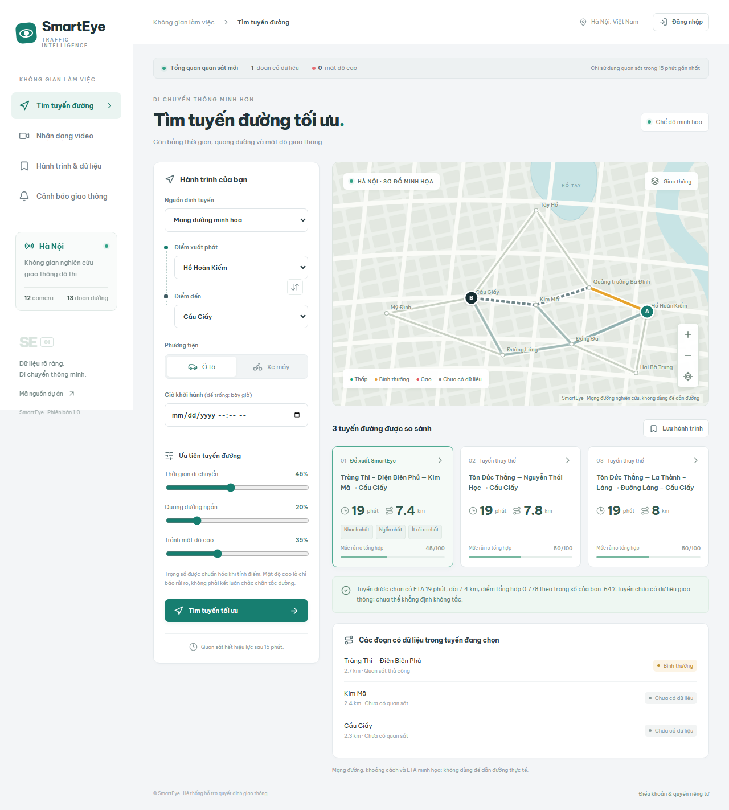

# SmartEye

Phân tích mật độ giao thông và hỗ trợ chọn tuyến tại Hà Nội: React + TypeScript, FastAPI, **MongoDB/PyMongo**, YOLO pretrained COCO.

## Dự báo và giao diện mới

Trang Tổng quan, dự báo 15/30 phút bằng XGBoost + GRU, chuẩn bị dữ liệu, nhãn ùn tắc thực tế, so sánh baseline và kích hoạt mô hình có kiểm soát. Không kèm mô hình đã huấn luyện cho Hà Nội; chưa đủ dữ liệu thì không trả dự báo. [Hướng dẫn đầy đủ](docs/FORECASTING.md).

## Bắt đầu

**Bản đồ đường phố OpenStreetMap, nhập số nhà/ngõ, chọn ghim và Dijkstra/A* trên mạng đường thực:** [docs/MAPS.md](docs/MAPS.md). Không cần Google API key; độ phủ địa chỉ và dịch vụ công cộng có giới hạn.

**Lệnh Windows đầy đủ, từng terminal, MongoDB portable/Atlas, backend/frontend và Docker:** [docs/RUNNING.md](docs/RUNNING.md).

**Collection, tài khoản mẫu, cách xem/import bằng Compass:** [database/README.md](database/README.md).

Compass là ứng dụng quản lý kết nối; cần MongoDB Server hoặc Atlas để lưu dữ liệu. Có script tải MongoDB portable Windows, không phải cài service. Runtime chỉ dùng MongoDB. SQL cũ được giữ trong `database/legacy-sql/`, không tự di chuyển dữ liệu.

## Tài khoản demo local

Chạy `scripts/init_db.py --demo-accounts` theo hướng dẫn trước khi đăng nhập:

| Vai trò | Email | Mật khẩu demo |
|---|---|---|
| Admin | admin@smarteye.test | SmartEyeAdmin@2026 |
| Analyst | analyst@smarteye.test | SmartEyeAnalyst@2026 |
| User | user@smarteye.test | SmartEyeUser@2026 |

Thông tin công khai chỉ dành cho demo. Startup không tự tạo các tài khoản này. Script giữ nguyên password/role/trạng thái tài khoản đã tồn tại. Bản thật dùng `scripts/create_admin.py` nhập email/mật khẩu riêng. Password trong MongoDB là scrypt hash có salt.

## Chức năng

- Bản đồ OpenStreetMap kéo/phóng to, nhập số nhà/ngõ với gợi ý Photon và ghim A/B. Tìm A–B bằng Dijkstra/A* theo thời gian + khoảng cách, mặc định 60/40; tối đa ba phương án, có chiều đường và hạn chế rẽ OSM. [Phạm vi mạng đường, ETA và giới hạn nguồn công cộng](docs/MAPS.md).
- Video gắn camera/đường: hàng đợi, tiến độ, hủy, lịch sử, ảnh bounding box, biểu đồ từng giây, LOW/NORMAL/HIGH.
- Admin hiệu chỉnh ROI/sức chứa/ngưỡng; video giữ snapshot cấu hình. Analyst/Admin xác nhận trước khi công bố quan sát mới.
- Đăng ký, đăng nhập, hồ sơ, đổi/reset mật khẩu qua SMTP; cookie HttpOnly, session thu hồi được, RBAC User/Analyst/Admin.
- Hành trình yêu thích tính lại khi mở; cảnh báo trong ứng dụng, chống lặp 10 phút; báo cáo và CSV.
- Quản trị user/camera/đường/audit; unique index, TTL token, validation và cập nhật trạng thái video có điều kiện.
- Trang **Camera & giao thông**: xem ảnh/video đã được cho phép chia sẻ theo từng đường, số xe và trạng thái mới/cũ; nguồn thử là video tải lên.
- Thống kê **ngày/tháng**, biểu đồ 24 giờ, bản đồ nhiệt ngày × giờ, khung giờ thường mật độ cao có điều kiện đủ dữ liệu. Tìm tuyến có thể tham khảo lịch sử 28 ngày cùng thứ/giờ khi đủ bằng chứng. Xem [hướng dẫn Camera và thống kê](docs/CAMERAS.md).

## Dữ liệu và phạm vi

Video tối đa 150 MB / 300 giây. Lấy mẫu một ảnh/giây, đếm car/motorcycle/motorbike/bus/truck cả khi đứng yên. Score `min(1,max(occupancy,vehicle_count/capacity))`, occupancy tính hợp bounding box trong ROI. Tổng hợp bằng trung vị score; số xe là hiện diện mỗi ảnh, không phải lưu lượng xe đi qua.

Chỉ Analyst/Admin công bố clip mới trong 15 phút; có luồng lưu lịch sử riêng cho clip cũ có thời điểm quay. Một video được đưa vào dữ liệu một lần. Mặc định xóa video gốc sau xử lý/hủy; có thể chọn giữ riêng tư trước phân tích và cho phép chia sẻ riêng sau đó. Xóa kết quả sẽ xóa video/ảnh của clip, giữ số liệu đã công bố. Demo có 13 đoạn nối 9 địa điểm, 4 camera, geometry/km/vận tốc minh họa; dữ liệu thiếu có rủi ro trung tính 0,5.

Có pipeline dự báo phân loại 15/30 phút bằng XGBoost/GRU, cần dữ liệu/nhãn thực và kích hoạt sau đánh giá; không kèm mô hình dự báo đã huấn luyện cho Hà Nội. Chưa có RTSP hoặc GPS dẫn đường từng chặng. Detector pretrained COCO và quy tắc mật độ cần nhãn thực để đánh giá ngoài hiện trường.

Google thật dùng hai khóa riêng `GOOGLE_ROUTES_API_KEY`/`GOOGLE_MAPS_BROWSER_KEY`, bật API/billing và giới hạn khóa phù hợp, sau đó restart backend. Không cần khóa Google cho OpenStreetMap hoặc demo. Giữ Google ETA; camera chỉ bổ sung rủi ro khi đường đã khảo sát khớp tuyến. Không lưu Google responses/polyline vào DB/CSV/training; xem [Routes policies](https://developers.google.com/maps/documentation/routes/policies).

## Tài liệu

[Cách chạy](docs/RUNNING.md) · [Database](database/README.md) · [Nghiệp vụ](docs/business-rules.md) · [Kiến trúc](docs/architecture.md) · [API](docs/api.md) · [Kiểm thử](docs/validation.md).

`src/`: frontend · `backend/app/`: API/PyMongo/RBAC/worker · `backend/tests/`: Pytest · `tests/e2e/`: Playwright · `scripts/`: bootstrap/download/kiểm tra · `deploy/`: Nginx/Mongo init.
