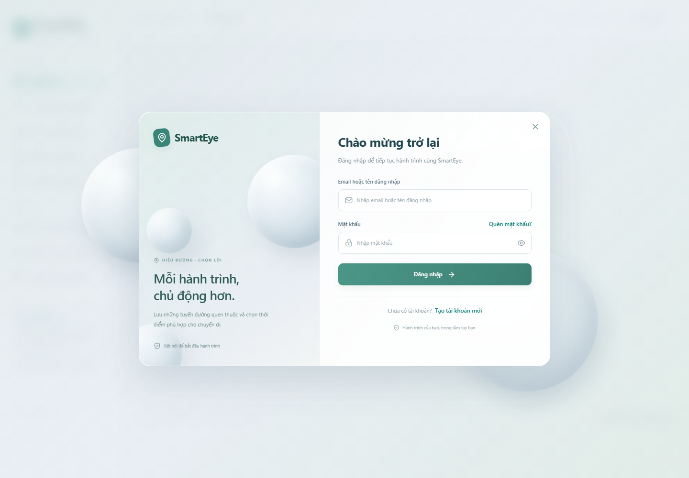
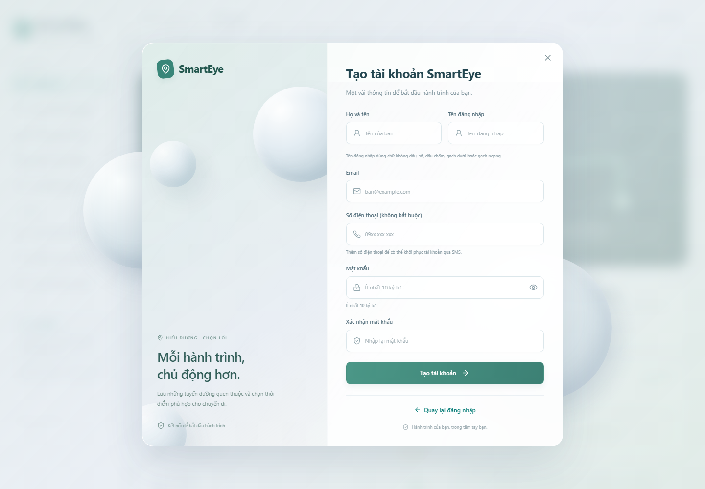

# Đăng nhập, đăng ký và khôi phục bằng OTP

Mở **Đăng nhập** để xem giao diện kính mờ. Nút mắt cho phép hiện/ẩn mật khẩu; **Tạo tài khoản mới** mở form đăng ký. Form có họ tên, tên đăng nhập, email, số điện thoại tùy chọn, mật khẩu và xác nhận. Đăng ký xong quay về đăng nhập.

**Quên mật khẩu?** luôn mở được. Trước đây nút này bị khóa khi máy chủ chưa có SMTP. Bản mới cho mở trang khôi phục và thông báo rõ nếu cách nhận mã chưa được cấu hình.

## Luồng người dùng

1. Chọn **Quên mật khẩu?**.
2. Chọn **Qua email** hoặc **Qua SMS**.
3. Nhập đúng email hoặc số điện thoại đã lưu khi đăng ký. Số Việt Nam 10 chữ số bắt đầu bằng `0` được đối chiếu thêm với định dạng `+84`. Nếu hai tài khoản cũ dùng hai định dạng tương đương, hệ thống không tự chọn một tài khoản để tránh đổi nhầm.
4. Nhấn **Gửi mã OTP**. Nếu thông tin trùng tài khoản đang hoạt động, hệ thống gửi mã 6 chữ số tới chính liên hệ đã lưu. Thông báo yêu cầu mã giữ cùng nội dung cho tài khoản tồn tại/không tồn tại.
5. Nhập mã và chọn **Xác nhận mã**. Chỉ sau bước này mới hiện form mật khẩu mới.
6. Nhập mật khẩu mới từ 10 ký tự và xác nhận trùng khớp, chọn **Đặt lại mật khẩu**.
7. Đăng nhập lại bằng mật khẩu mới. Các phiên đăng nhập cũ bị thu hồi.

Mã có hiệu lực 10 phút, chỉ xác nhận một lần. Mỗi lượt được thử tối đa 5 lần. Gửi lại cần chờ 60 giây; mỗi tài khoản tối đa 5 lượt gửi trong một giờ, tính chung email và SMS. Mã mới thay lượt cũ. Sau xác nhận, có 5 phút để đặt mật khẩu mới. Đổi mật khẩu, khóa tài khoản hoặc đổi thông tin liên hệ làm lượt khôi phục cũ không còn dùng được.

## Cấu hình gửi email

Thông tin người nhận không thay thế tài khoản gửi email. Điền các trường sau trong `.env` tại thư mục dự án; không đưa mật khẩu vào chat hoặc Git:

```dotenv
SMTP_HOST=smtp.gmail.com
SMTP_PORT=587
SMTP_SECURITY=starttls
SMTP_USER=email-gui-cua-ban@gmail.com
SMTP_PASSWORD=MAT_KHAU_UNG_DUNG_CUA_EMAIL_GUI
SMTP_FROM=email-gui-cua-ban@gmail.com
```

Nếu dùng Gmail, tạo **mật khẩu ứng dụng** theo [hướng dẫn Google](https://support.google.com/accounts/answer/185833?hl=vi). Cấu hình SMTP Gmail có thể dùng cổng 587 với STARTTLS hoặc 465 với SSL; với cổng 465 đổi `SMTP_SECURITY=ssl`. [Thiết lập máy chủ gửi thư của Google](https://developers.google.com/workspace/gmail/imap/imap-smtp?hl=vi).

Với SMTP khác, dùng máy chủ, cổng, người gửi và thông tin xác thực do nhà cung cấp cho phép. Kết nối dùng TLS và kiểm tra chứng chỉ. `SMTP_SECURITY=none` chỉ phục vụ SMTP thử nghiệm trên máy cục bộ trong development, không được dùng ở production.

## Cấu hình SMS Twilio

```dotenv
TWILIO_ACCOUNT_SID=AC_THAY_BANG_ACCOUNT_SID_CUA_BAN
TWILIO_AUTH_TOKEN=THAY_BANG_AUTH_TOKEN_CUA_BAN
TWILIO_FROM=THAY_BANG_NGUOI_GUI_DUOC_TWILIO_CAP
TWILIO_MESSAGING_SERVICE_SID=
```

`TWILIO_FROM` là số hoặc định danh người gửi được Twilio cho phép, **không phải số điện thoại nhận OTP**. Nếu đã có Messaging Service, điền `TWILIO_MESSAGING_SERVICE_SID` và có thể để trống `TWILIO_FROM`. API dùng `MessagingServiceSid` khi trường này có giá trị. [Tài liệu gửi tin nhắn Twilio](https://www.twilio.com/docs/messaging/api/message-resource).

Tài khoản thử nghiệm có giới hạn người nhận đã xác minh và quyền gửi theo quốc gia; kiểm tra trong Twilio Console. [Giới hạn Twilio Trial](https://www.twilio.com/docs/usage/tutorials/how-to-use-your-free-trial-account). Gửi tới Việt Nam còn phụ thuộc người gửi và mẫu tin đã đăng ký theo yêu cầu nhà mạng. [Hướng dẫn SMS Việt Nam của Twilio](https://www.twilio.com/en-us/guidelines/vn/sms).

Hệ thống chuyển số Việt Nam dạng `0xxxxxxxxx` thành `+84xxxxxxxxx` khi gửi. Số quốc tế cần có dấu `+` và mã quốc gia. Cần dùng thông tin dịch vụ có khả năng gửi thật; giá trị mẫu trong tài liệu không phải thông tin đăng nhập.

## Khóa bảo vệ mã và áp dụng cấu hình

`AUTH_OTP_SECRET` là khóa riêng tối thiểu 32 ký tự, dùng để băm OTP. `scripts/setup_env.py` tạo khóa khi chưa có và giữ khóa hiện hữu. Máy hiện tại đã được thêm khóa tự sinh cùng các ô cấu hình email/SMS; chưa điền thay thông tin dịch vụ của người dùng. Giữ khóa riêng, ổn định giữa các backend và không ghi vào Git.

Sau khi tự điền thông tin gửi mã vào `.env`, áp dụng lại môi trường container:

```powershell
cd C:\Users\Admin\Documents\GitHub\SmartEye
docker compose up -d --no-build --force-recreate --wait backend frontend
Invoke-RestMethod http://localhost:8081/api/config | Select-Object -ExpandProperty password_reset_channels
```

Kết quả `email=True`/`sms=True` cho biết cấu hình tương ứng đã đủ về hình thức, không phải xác nhận email/SMS đã đến. Nhà cung cấp vẫn có thể từ chối thông tin đăng nhập, người gửi, hạn mức hoặc người nhận. Với backend chạy trực tiếp, khởi động lại FastAPI sau khi sửa `.env`.

Mở trang, đăng ký/kiểm tra hồ sơ của chính bạn có đúng liên hệ, rồi thử khôi phục từng cách. Nếu chưa nhận được, kiểm tra thư rác, thông tin gửi, quyền/hạn mức của dịch vụ và log:

```powershell
docker compose logs --tail 80 backend
```

Log chỉ ghi lỗi gửi theo kênh, không ghi OTP hoặc thông tin xác thực nhà cung cấp. Không có mã tĩnh hoặc API công khai để đọc OTP.

## API và dữ liệu

- `POST /api/auth/forgot-password`: `{ "identifier": "email hoặc số điện thoại", "delivery": "email hoặc sms" }`. Trả challenge ngẫu nhiên, hạn dùng và thời gian chờ gửi lại; không trả mã. Trường `email` cũ vẫn được chấp nhận khi dùng kênh email.
- `POST /api/auth/verify-reset-otp`: `{ "challenge": "...", "code": "123456" }`. Chỉ đúng mã, đúng tài khoản/liên hệ, còn hạn và chưa dùng mới nhận token đặt lại mật khẩu.
- `POST /api/auth/reset-password`: `{ "token": "...", "password": "...", "password_confirmation": "..." }`. Token gắn với phiên bản tài khoản và lượt xác nhận. Giữ tương thích các liên kết đặt lại cũ còn hợp lệ.
- `password_otps`: OTP băm HMAC, challenge băm, số lần thử, phiên bản và liên hệ tài khoản, lịch sử yêu cầu gửi. Không lưu mã gốc. Hạn xác nhận được kiểm tra trực tiếp; TTL giữ bản ghi khoảng một giờ để bảo toàn giới hạn gửi, rồi tự dọn.
- `reset_tokens`: token ngẫu nhiên được băm, chỉ có quyền đổi mật khẩu. Xác nhận một lần bằng cập nhật có điều kiện; cập nhật mật khẩu có kiểm tra phiên bản để tránh dùng đồng thời token cũ.

Cách xử lý dựa trên [khuyến nghị khôi phục mật khẩu OWASP](https://cheatsheetseries.owasp.org/cheatsheets/Forgot_Password_Cheat_Sheet.html): thông báo chung, giới hạn yêu cầu/thử mã, mã dùng một lần, hết hạn và đăng nhập lại sau khôi phục.

## Kiểm tra

Backend kiểm tra email/SMS, số Việt Nam, liên hệ không tồn tại, mã sai/hết hạn/dùng lại, gửi lại, giới hạn giờ, yêu cầu đồng thời, thu hồi phiên và token cũ, khóa/đổi liên hệ tài khoản, lỗi gửi và TLS. Kiểm thử dịch vụ gửi dùng transport giả lập, không gửi mã tới người thật hoặc tính phí Twilio.

E2E kiểm tra đăng ký/đăng nhập thật trên database riêng và luồng giao diện OTP theo hợp đồng API trên desktop/mobile. Gửi email/SMS thực tế chỉ được xác nhận sau khi điền dịch vụ thật và người nhận nhận được mã.





[Đăng nhập trên điện thoại](previews/auth-login-mobile.png), [đăng ký trên điện thoại](previews/auth-register-mobile.png).
