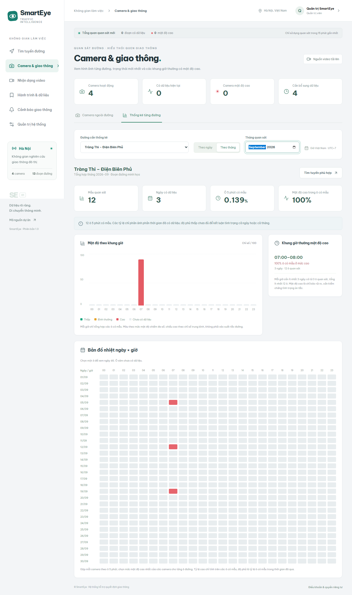

# Camera đường phố và thống kê ngày/tháng

Phiên bản này dùng **video tải lên**, theo lựa chọn thử nghiệm của chủ dự án. Hình ảnh/video trên trang Camera được gắn thời điểm quay và quyền chia sẻ; không giả lập chúng thành nguồn LIVE. Chưa có URL camera trực tiếp để tích hợp.

Ảnh trên dùng dữ liệu tổng hợp trong database kiểm thử riêng để kiểm tra biểu đồ và điều kiện lặp lại; không phải kết luận giao thông thực tế của đường trong ảnh.

## Thử một camera từ video

1. Đăng nhập Admin hoặc Quản lý (role `analyst`). Trong **Quản trị → Đoạn đường / Camera**, tạo hoặc chọn đúng đoạn đường và camera. Có thể dùng đường minh họa để thử; muốn sử dụng Hoàng Quốc Việt thực tế cần nhập đúng hình học và hiệu chỉnh camera tại vị trí đó.
2. Mở **Camera & giao thông**, chọn **Tải video** trên camera muốn thử. Hoặc mở Nhận dạng video và chọn camera.
3. Chọn video. Nhập **thời điểm bắt đầu ghi hình thật**. Mỗi khung hình được gắn thời điểm này cộng số giây trong clip; thời điểm tải tệp không thay cho thời điểm quay.
4. Nếu muốn phát lại clip trên trang Camera, tích **Giữ video để xem lại và có thể chia sẻ lên trang Camera** trước khi phân tích. Mặc định không giữ video gốc. Ưu tiên MP4 H.264 hoặc WebM để trình duyệt phát được.
5. Bấm **Phân tích mật độ giao thông**. Chờ hoàn tất. Tác vụ chưa hoàn tất/lỗi/hủy không được đưa vào lịch sử.
6. Chọn riêng **Cho phép mọi người xem ảnh và video đã giữ trên trang Camera** nếu có quyền chia sẻ. Không chọn thì các ảnh/video vẫn riêng tư, dù số liệu quan sát đã được công bố.
7. Dùng **Xác nhận cập nhật đoạn đường** cho clip mới (trong 15 phút), hoặc **Lưu vào lịch sử** cho clip quay từ trước. Cả hai lưu chuỗi mẫu theo thời điểm quay; dữ liệu cũ không trở thành trạng thái hiện tại.
8. Mở Camera & giao thông. Thẻ camera hiển thị ảnh, số ô tô/xe máy/tổng xe mỗi ảnh và thời điểm quan sát. Bấm ảnh để phóng to/phát video đã chia sẻ. Video cũ có nhãn dữ liệu cũ; thông tin thiếu vẫn hiển thị chưa có dữ liệu.

User thường phân tích video của mình; Quản lý chỉ công bố video của mình, Admin có thể công bố video thuộc quyền quản lý. Mỗi video được đưa vào dữ liệu một lần. Sau khi đã lưu, có thể dùng **Áp dụng quyền chia sẻ ảnh/video** để công khai hoặc ẩn ảnh/video mà không tạo trùng thống kê.

## Xem một ngày hoặc một tháng

- Mở **Camera & giao thông → Thống kê từng đường** hoặc bấm **Thống kê ngày / tháng** trên thẻ camera.
- Chọn đường, **Theo ngày / Theo tháng**, rồi chọn khoảng thời gian. Mọi khung giờ thống kê dùng giờ Việt Nam UTC+7.
- Biểu đồ 24 giờ hiển thị chỉ số mật độ trung bình trong những ô có mẫu. Ô/giờ trống có màu xám; không được coi là đường thông thoáng.
- Chế độ tháng có bản đồ nhiệt **ngày × giờ**. Bấm một ô để mở chi tiết ngày đó; các ngày tương lai bị khóa.
- Danh sách **Khung giờ thường mật độ cao** chỉ xuất hiện khi một giờ có ít nhất **3 ngày**, mỗi ngày có từ **3 ô 5 phút có mẫu**, tổng ít nhất **12 ô**. Chỉ liệt kê giờ có từ 50% ô quan sát được phân loại HIGH.
- Ví dụ muốn tìm khung giờ thường đông trên Hoàng Quốc Việt: gắn video/quan sát đúng đoạn đường và thời điểm, bổ sung dữ liệu nhiều ngày, rồi xem tháng. Hệ thống không tự tạo dữ liệu giao thông của các ngày chưa quan sát.

**Cách tổng hợp:** Trung bình các mẫu của từng camera trong mỗi ô 5 phút, chọn mức mật độ đại diện theo phiếu các mẫu (HIGH ưu tiên khi đạt 50%). Nếu một đường có nhiều camera, lấy mức mật độ cao nhất trong ô, rồi so chỉ số khi cùng mức. Mỗi ô đường chỉ có một trọng số, tránh video nhiều khung hình hoặc nhiều camera làm sai lệch thống kê.

**Độ phủ** là tỷ lệ ô 5 phút có ít nhất một mẫu trong thời gian đã trôi qua của ngày/tháng. Một mẫu trong ô không chứng minh đã theo dõi liên tục toàn bộ 5 phút. Tỷ lệ mật độ cao chỉ tính trong các ô có mẫu, không phải xác suất ùn tắc hoặc tỷ lệ thời gian tắc của cả tháng.

## Dữ liệu này ảnh hưởng tìm tuyến thế nào?

- Tìm tuyến hiện tại ưu tiên các quan sát camera còn hiệu lực. Khi nhiều camera trên một đường còn hiệu lực, sử dụng mức cao nhất để đánh giá rủi ro.
- Khi thiếu quan sát hiện tại, chỉ dùng thống kê lịch sử nếu đủ bằng chứng.
- Với giờ khởi hành cách hiện tại trên 5 phút, dữ liệu camera hiện tại không được coi là dự báo. Hệ thống tìm lịch sử **28 ngày gần nhất, cùng thứ và giờ**, với cùng điều kiện số ngày/số ô tối thiểu.
- Kết quả tuyến ghi rõ **Lịch sử cùng thứ/giờ**, số ngày bằng chứng và phần chưa có dữ liệu. Đây là tham khảo mẫu lặp lại, chưa phải mô hình dự báo được huấn luyện.
- Google ETA được giữ nguyên. Camera/lịch sử chỉ bổ sung rủi ro khi đoạn đã khảo sát khớp tuyến; đường đánh dấu minh họa không sửa kết quả Google.

## Lưu trữ và quyền riêng tư

- MongoDB có thêm `traffic_samples`, chứa mẫu được công bố theo thời gian; index unique `sample_key`, index đường/thời điểm và camera/thời điểm.
- Quan sát cũ trước phiên bản này vẫn được dùng làm dữ liệu lịch sử ở độ chi tiết ban đầu. Quan sát đã có mẫu chi tiết không bị đếm thêm lần nữa.
- Khung hình của video chưa được công bố vẫn chỉ chủ tài khoản và Admin truy cập. Video giữ lại có endpoint riêng tư tương tự.
- Ảnh/video công khai chỉ phục vụ camera đã được cấp quyền chia sẻ. Ngừng camera/đường hoặc chuyển camera sang đường khác sẽ chặn ảnh/video ở vị trí cũ.
- Xóa kết quả video sẽ xóa video giữ lại và bản ảnh/video chia sẻ của clip đó; số liệu quan sát và mẫu đã công bố vẫn giữ để bảo toàn báo cáo.
- Mặc định xóa video gốc sau xử lý. Tùy chọn giữ lại dùng thêm dung lượng; chủ tài khoản/Admin có thể xóa kết quả để dọn ảnh/video.

## Kiểm thử

Backend tests có kiểm tra ngày/tháng UTC+7, tháng nhuận, dữ liệu thiếu, nhiều camera/ngưỡng khác nhau, chuẩn hóa ô thời gian, lưu lịch sử, quyền chia sẻ, HTTP Range video và tránh dùng quan sát hiện tại cho giờ tương lai.

E2E kiểm tra trang camera, bộ lọc, biểu đồ tháng, phát WebM sau YOLO, lưu lịch sử và khung giờ lặp lại qua nhiều ngày. E2E sử dụng database `smarteye_e2e` riêng. Có thể đặt `SMARTEYE_E2E_API_URL` để sử dụng backend test trong Docker; không trỏ biến này vào dữ liệu triển khai thật.

Nếu Windows báo Application Control chặn `torch_python.dll`, sử dụng backend Docker thay vì thay đổi chính sách bảo vệ hệ điều hành. Đảm bảo ổ chứa Docker còn đủ chỗ cho image và quá trình giải nén.
