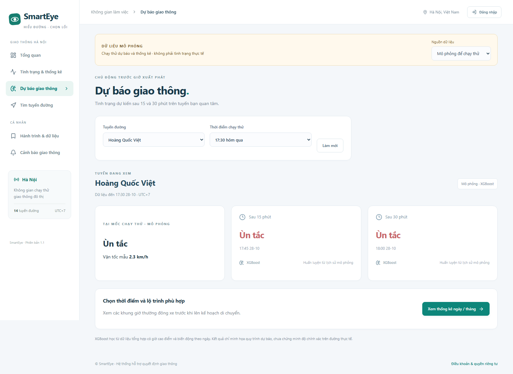

# Dữ liệu minh họa và lịch sử một năm

**Bản mới:** xem [PLANNING.md](PLANNING.md) để dự báo ngày mai, chọn ngày/giờ và so sánh giờ khởi hành. Giao diện đã bỏ thanh nguồn phía trên và tên mô hình khỏi trang người dùng. Các mô tả màn hình chạy lại giờ hôm qua bên dưới chỉ áp dụng cho bản cũ; API ngắn hạn vẫn được giữ.

Bản này có chế độ **Mô phỏng để chạy thử**, tự chuẩn bị ở lần khởi động đầu trong môi trường development. Không cần tải video hay tự nhập hàng nghìn dòng dữ liệu.

## Chạy trên máy hiện tại

```powershell
cd C:\Users\Admin\Documents\GitHub\SmartEye
docker compose up -d --wait --wait-timeout 240
```

Mở http://localhost:8081. Ở đầu trang chọn **Mô phỏng để chạy thử**.

1. **Dự báo giao thông** → chọn Hoàng Quốc Việt hoặc tuyến khác → xem hiện tại và sau 15/30 phút.
2. Chọn **07:30 hôm qua** hoặc **17:30 hôm qua** để thử lại giờ cao điểm; các ngày/giờ trên thẻ là mốc chạy thử, không phải thời gian hiện tại.
3. **Tình trạng & thống kê** → tìm tên đường → chọn ngày/tháng → xem biểu đồ 24 giờ, khung giờ thường đông xe và bản đồ nhiệt. Bấm ô tháng để mở ngày đó.
4. **Tải CSV mẫu** để lấy dữ liệu ra làm báo cáo. CSV ghi rõ `source=synthetic`.
5. **Tìm tuyến đường** → nhập địa chỉ và chọn kết quả hoặc ghim A/B → chọn ưu tiên thời gian/khoảng cách. Tình trạng mô phỏng chỉ điều chỉnh ETA trên phần tuyến trùng tên các đường mẫu; những phần khác chưa có dữ liệu.
6. Đổi nguồn sang **Quan sát thực tế** để kiểm tra trạng thái thiếu dữ liệu. Mẫu mô phỏng không được đưa vào bảng quan sát thực hay tự kích hoạt mô hình thực.

Dừng bằng `docker compose stop`, chạy lại bằng `docker compose up -d`. Không cần tạo lại dữ liệu mỗi lần.

## Tạo hoặc huấn luyện lại

Docker:

```powershell
docker compose exec backend python scripts/prepare_demo.py --days 365
Invoke-RestMethod http://localhost:8081/api/demo/status
```

Local, sau khi MongoDB và `.env` đã đúng:

```powershell
.venv\Scripts\python.exe -m pip install -r backend/requirements.txt
.venv\Scripts\python.exe scripts/prepare_demo.py --days 365
```

Hoặc Admin mở **Quản trị hệ thống → Dữ liệu & mô hình**, hay Quản lý phụ trách toàn bộ tuyến có quyền mô hình mở **Giám sát & xử lý → Dữ liệu & thiết lập → Dữ liệu & mô hình**, rồi bấm **Cập nhật lịch sử** khi bộ mẫu cần chuẩn bị. Huấn luyện chạy nền; dữ liệu cũ tiếp tục dùng đến khi bộ mới hoàn tất. Khi đã sẵn sàng, script có thể tạo lại bộ mẫu mà không xóa dữ liệu thực.

Backend và frontend chạy local theo [RUNNING.md](RUNNING.md). Không cần `download_model.py` để dùng dự báo mới.

## Dữ liệu được tạo như thế nào?

- Seed cố định 42, chu kỳ sáng/chiều, sự khác biệt từng đường, cuối tuần và nhiễu có tương quan theo thời gian. Thỉnh thoảng có một đợt đông xe ngoài giờ cao điểm.
- Mỗi 5 phút có chỉ số mật độ, số xe minh họa, tốc độ mẫu và nhãn FREE / SLOW / JAM. Nhãn mô phỏng dựa trên tỷ lệ tốc độ mẫu / tốc độ thông thoáng: dưới 0,30 là JAM, dưới 0,65 là SLOW, còn lại FREE. Đây là quy ước của bộ sinh, không phải tiêu chuẩn đánh giá giao thông thực.
- Tạo 365 ngày trước cùng ngày hiện tại cho tối đa 20 tuyến đang hoạt động, gồm Hoàng Quốc Việt. Nếu tuyến mẫu này chưa có, chỉ thêm bản ghi mới có `is_demo=true`; không sửa tuyến của bạn.
- XGBoost học từ 8 ngày trước, dùng 12 mốc lịch sử liên tiếp (60 phút), số xe, chỉ số/nhãn lịch sử, giờ, thứ và mã tuyến. Ngày hiện tại không tham gia huấn luyện.
- Hai mô hình cho 15 và 30 phút. Chia 60/20/20 theo thời gian; nhãn train/validation phải nằm trước phần kế tiếp. Chuẩn hóa chỉ fit trên train. Có báo cáo so với cách giữ nguyên trạng thái.
- Lúc dự báo chỉ đọc mốc đến thời điểm yêu cầu; không lấy nhãn tương lai từ bộ sinh để trả thay mô hình. Không coi điểm tốt trên dữ liệu tổng hợp là độ chính xác trên đường thật.
- Các ngày bị bỏ lỡ khi máy tắt được sinh bù trong cửa sổ 31 ngày khi xem báo cáo. Phần tương lai của ngày/tháng vẫn trống.

## Lưu ở đâu?

| Nơi lưu | Nội dung |
|---|---|
| MongoDB `demo_profiles` | Các mốc 5 phút được nhóm theo ngày và đường; có `source=synthetic`, mã bộ dữ liệu riêng |
| MongoDB `demo_registry` | Bộ mẫu đang dùng và trạng thái chuẩn bị |
| `backend/data/demo-forecasts/<UUID>/` | Hai mô hình XGBoost và metadata đánh giá |

Không ghi mẫu vào `observations`, `traffic_samples`, `traffic_labels`, `forecast_runs` hay `forecast_registry`. Dữ liệu/tài khoản cũ và các video lưu trữ được giữ nguyên. Compass kết nối MongoDB Docker qua **127.0.0.1:27018** bằng tài khoản database trong `.env` rồi mở DB theo `MONGODB_DB`; 27017 có thể là một server khác.

## Cấu hình và API

- `DEMO_DATA_ENABLED`: mặc định bật ở development, tắt ở production; chỉ bật ở production nếu chủ ý triển khai một bản demo có nhãn.
- `DEMO_AUTO_PREPARE=true`, `DEMO_HISTORY_DAYS=365`, `DEMO_ESTIMATORS=96`.
- `VIDEO_FEATURE_ENABLED=false`: tắt API tải video cá nhân và giao diện nhận diện cũ. Trang Camera vẫn phát và phân tích lại các video mẫu đã được chuẩn bị theo hướng dẫn bên dưới.
- `OSRM_URL=https://router.project-osrm.org`: nguồn ô tô nhanh; cache ứng viên 10 phút, trọng số và dữ liệu giao thông được tính lại theo từng yêu cầu. Xe máy dùng mạng OSM đầy đủ; không thay bằng tuyến xe đạp hay tuyến ô tô không kiểm tra quyền.
- `GET /api/demo/status`, `GET /api/demo/predict?segment_id=14`.
- `GET /api/demo/predict?segment_id=14&issue_at=<ISO có múi giờ trong 30 ngày đã qua (API ngắn hạn cũ)>`.
- `GET /api/demo/history?segment_id=14&period=month&value=2026-10` (thay ID/tháng bằng dữ liệu của bạn).
- `GET /api/demo/export.csv?segment_id=14`.
- `POST /api/demo/prepare` yêu cầu Admin hoặc Quản lý phụ trách toàn bộ tuyến có quyền `models.manage`, không cần gửi body.
- `GET /api/bootstrap?data_mode=demo` khởi tạo trang bằng một request.
- `POST /api/routes/search` có `provider=auto`, `algorithm=astar`, `traffic_mode=demo|observed`. Ô tô mặc định xếp hạng các ứng viên OSRM; `provider=demo|osm` dùng đồ thị đầy đủ và A*, còn `algorithm=compare` chỉ phục vụ kiểm chứng qua API.

## Khi cần dữ liệu thật

Giữ dữ liệu mẫu để thử giao diện. Với nghiên cứu chính thức, dùng CSV quan trắc được phép sử dụng hoặc dữ liệu mở có thời gian/địa điểm rõ ràng; Admin hoặc Quản lý có quyền mô hình nhập lịch sử và nhãn đã kiểm chứng trong **Dữ liệu & mô hình**, huấn luyện rồi đánh giá trước khi kích hoạt. Không nhập CSV tổng hợp vào chế độ thực và gọi nó là dữ liệu thu thập tại Hà Nội. Pipeline GRU và XGBoost cho dữ liệu thực vẫn có tại [FORECASTING.md](FORECASTING.md).

## Ảnh từ Docker sau cập nhật

Các ảnh dưới đây dùng bộ dữ liệu mô phỏng riêng trong Docker, không phải camera hay tình trạng thực của Hà Nội.



[Dự báo trên điện thoại](previews/forecast-demo-mobile.png) · [Thống kê tháng trên máy tính](previews/traffic-demo-desktop.png) · [Thống kê tháng trên điện thoại](previews/traffic-demo-mobile.png).

## Video camera và dự báo mật độ

Trang **Camera giao thông** có video minh họa từ Pexels, ô nhận diện và số xe đồng bộ từng khung hình bằng YOLO11. Dự báo chạy thử sau 15, 30, 60 phút có phần trăm ùn tắc và nút **Vì sao?**. Hai clip được gắn luân phiên vào bốn camera để thử nhiều tuyến, không phải hình ảnh trực tiếp hoặc bằng chứng rằng video quay ở đúng tuyến đang chọn.

| Video | Tác giả | Nguồn và quyền sử dụng |
|---|---|---|
| Bustling Hanoi Street Captured from Above | Nimit N | [Video gốc](https://www.pexels.com/video/bustling-hanoi-street-captured-from-above-31873135/), [Pexels License](https://www.pexels.com/license/) |
| Busy Urban Traffic Scene in Hanoi | Sandeep Kumar | [Video gốc](https://www.pexels.com/video/busy-urban-traffic-scene-in-hanoi-35369134/), [Pexels License](https://www.pexels.com/license/) |

Tên địa điểm theo mô tả của người đăng, chưa xác minh đường và thời điểm ghi hình. Nguồn, tác giả, ngày công bố, giấy phép và ghi chú vị trí được giữ trong `database/camera-video-sources.json`, metadata của tác vụ và trang xem. Video được bỏ âm thanh, nén H.264 tối đa 960px, 15fps để phát nhanh. Tệp gốc khoảng 165 MB cho hai clip, tệp dùng để phát khoảng 1,5 MB và 2 MB. Dữ liệu lớn nằm trong `backend/data`, không đưa lên GitHub.

**Cài hoặc cập nhật bằng PowerShell**

```powershell
cd C:\Users\Admin\Documents\GitHub\SmartEye
docker compose up -d --build --wait --wait-timeout 240
docker compose exec backend python scripts/download_model.py
docker compose exec backend python scripts/setup_camera_videos.py
```

Nếu báo chưa có lịch sử minh họa, chạy `docker compose exec backend python scripts/prepare_demo.py --days 365` rồi chạy lại bước chuẩn bị video. Bước này dành cho môi trường demo có `DEMO_DATA_ENABLED=true`. Không cần bật `VIDEO_FEATURE_ENABLED`.

Script chuẩn bị mô hình mật độ riêng, tải/nén video nếu chưa có, gắn vào camera 1–4 đang có tuyến hoạt động và chạy YOLO. Camera được chọn sẽ được bật và chia sẻ video. Vùng quan sát/sức chứa mẫu chỉ được áp dụng cho camera chưa từng phân tích có cấu hình mặc định; không ghi đè hiệu chỉnh riêng. Khi đã hoàn tất, chạy lại sẽ dùng kết quả cũ nếu video, cấu hình và bộ lịch sử không đổi. Có thể chỉ định `--camera-id 1 --camera-id 3` hoặc thêm `--refresh` để phân tích lại. Tuyến ngoài bộ lịch sử minh họa vẫn xem được mật độ video nhưng sẽ báo chưa đủ dữ liệu dự báo.

**Lần sau chạy** chỉ cần `docker compose up -d`, mở [Camera giao thông](http://localhost:8081/#cameras), chọn camera và nhấn phát. Các cột thời gian cho phép tua đến từng giây; ô nhận diện, tên loại xe và số đếm đổi theo khung hình tương ứng. Có nút ẩn/hiện ô; dùng nút phóng to ở góc trên video để xem rõ cùng lớp nhận diện. Nhấn **Vì sao?** bên dưới mỗi dự báo sẽ tạm dừng video, giải thích số xe, mức chiếm vùng đường, lịch sử cùng khung giờ và ý nghĩa tỷ lệ. Trong phần Camera & hiệu chỉnh, Admin hoặc Quản lý có quyền `network.manage` đúng phạm vi có thể nhấn **Phân tích lại video**. Video cũ vẫn xem được trong khi xử lý. Đổi ngưỡng/vùng quan sát yêu cầu phân tích lại; kết quả cũ được đánh dấu không còn phù hợp.

**Cách phân tích**

- YOLO11n nhận diện mọi khung hình của clip 15fps, không chỉ lấy một ảnh mỗi giây. Cắt vùng mặt đường trước khi nhận diện, đầu vào 960px, chỉ bốn lớp phương tiện, ngưỡng tin cậy 0,25, NMS không phân biệt lớp với IoU 0,5 để giảm ô đếm trùng. Tọa độ được trả lại trên toàn ảnh; ô và tên loại xe được vẽ ngay trên video theo thời điểm khung hình trình duyệt đang hiển thị. Tổng xe bằng số ô và tổng bốn loại xe ở cùng khung hình. Nhận diện có thể bỏ sót/nhầm xe nhỏ, bị che; chưa có nhãn thủ công để cam kết đếm đúng 100%.
- Chỉ số mật độ là giá trị lớn hơn giữa tỷ lệ vùng quan sát bị xe che phủ và số xe/sức chứa camera, giới hạn trong 0–1. Diện tích hộp chồng nhau chỉ tính một lần. Hai ngưỡng camera phân thành Thấp, Vừa, Cao. Khi chỉ số vượt `high + 0.65 × (1-high)`, giao diện ghi Rất cao. Đây là quy ước chạy thử cần hiệu chỉnh, không phải xác suất ùn tắc.
- Các xe có thể xuất hiện ở nhiều khung hình. Số xe/khung hình không phải lưu lượng xe/giờ; không suy ra tốc độ hay ùn tắc chắc chắn từ riêng số xe.
- **Xe đã ghi nhận từ đầu video** dùng ByteTrack để theo dõi mã xe qua các khung hình và chỉ cộng mỗi mã đã xác nhận một lần. Có tổng và bốn loại riêng; phân loại cộng dồn chốt khi mã được tính lần đầu để không nhảy số giữa các loại khi detector đổi nhãn. **Xe đang xuất hiện** vẫn là toàn bộ ô của khung hình hiện tại, dùng để tính mật độ. Khi tua lùi, số cộng dồn hiển thị kết quả đã tính đến mốc cũ, không cộng thêm do thao tác phát/tua. Bộ theo dõi có thể mất mã khi che khuất lâu, camera di chuyển hoặc xe ra/vào lại; chưa được xem số mã là số xe thật đã kiểm đếm chính xác hay số xe qua một vạch đếm.
- XGBoost có hai mục tiêu riêng: mật độ (Thấp/Vừa/Cao) và ùn tắc (FREE/SLOW/JAM), cho ba mốc 15/30/60 phút. Nhãn ùn tắc chỉ lấy từ trạng thái có sẵn của bộ sinh lịch sử, không đổi nhãn mật độ cao trực tiếp thành ùn tắc. Mô hình camera học từ 8 ngày hoàn chỉnh gần nhất của bộ lịch sử minh họa. Các phần train, early stopping, hiệu chỉnh xác suất và test tách theo thời gian, có khoảng cách giữa thời điểm nhãn và phần tiếp theo. Chuẩn hóa chỉ tính trên train. Hiệu chỉnh temperature scaling chỉ fit trên phần hiệu chỉnh; test không dùng chọn nhiệt độ hoặc dừng cây. Metadata có log loss, Brier cho lớp cao/ùn tắc và so sánh với giữ trạng thái hiện tại trên tập test.
- Phần trăm ùn tắc là xác suất lớp JAM từ `predict_proba`, sau temperature scaling. Không đặt cố định 90%, không dùng độ tin cậy hộp YOLO làm xác suất ùn tắc. Giải thích bổ sung số ngày có dữ liệu và số ngày ùn tắc cùng giờ/cùng thứ trong 100 ngày lịch trước ngày tham chiếu. Tần suất này được trình bày riêng, không giả làm xác suất do mô hình tính.
- Mỗi khung hình thay mốc mới nhất trong cửa sổ 60 phút bằng số xe/mật độ thực sự đo từ video; **11 mốc trước đó vẫn là dữ liệu tổng hợp**. Tất cả mốc trong một clip dùng cùng thời điểm tham chiếu chạy thử, không có thời điểm ghi hình thực đã xác minh. Phần dự báo vì vậy luôn ghi **chạy thử**. Không gọi kết quả đánh giá trên mẫu tổng hợp là độ chính xác ngoài đường.

Pipeline này không ghi vào `observations`, `traffic_samples`, `traffic_labels`, registry/mô hình dự báo thực hoặc cảnh báo thật. Nó lưu metadata, kết quả và video trong `video_jobs`, `cameras`, `backend/data/uploads`, `backend/data/camera_previews`, cache phát hiện theo nội dung tại `backend/data/camera-detections` và mô hình riêng tại `backend/data/camera-density/<UUID>/v2`. Clip tối đa 120 giây/1800 khung hình. Cache giữ bbox gốc theo SHA video, trọng số, ROI, phiên bản và tham số nhận diện; đổi sức chứa/ngưỡng chỉ tính lại mật độ, đổi ROI/trọng số cần nhận diện lại. Pipeline video cá nhân cũ giữ nguyên 1fps để tương thích, không tự mở lại giao diện upload. Bộ dự báo thực XGBoost/GRU giữ nguyên theo [FORECASTING.md](FORECASTING.md). Muốn đánh giá dự báo thật cần video/quan trắc liên tục, đúng tuyến và thời gian, nhãn đã kiểm chứng, rồi kiểm thử trên giai đoạn chưa dùng huấn luyện. Clip vài chục giây không cung cấp đủ lịch sử để chứng minh độ chính xác 80–90%.

Tham khảo triển khai: [cấu hình nhận diện Ultralytics](https://docs.ultralytics.com/modes/predict/), [đồng bộ khung hình trình duyệt](https://developer.mozilla.org/en-US/docs/Web/API/HTMLVideoElement/requestVideoFrameCallback), [ý nghĩa và đánh giá hiệu chỉnh xác suất](https://scikit-learn.org/stable/modules/calibration.html).

## Tình huống đông xe lúc 17:00

```powershell
docker compose exec backend python scripts/setup_camera_videos.py --rush-hour
```

Lệnh bổ sung tuyến **Ngã Tư Sở (minh họa)** và camera **Ngã Tư Sở · Tình huống 17:00**, giữ nguyên các tuyến/camera cũ. Nếu tuyến mới chưa có trong bộ mẫu, tạo lại lịch sử tổng hợp một năm và huấn luyện bộ dự báo demo có tuyến này trước khi phân tích camera. Không sửa dữ liệu quan trắc hoặc mô hình phục vụ dữ liệu thực. Mở Camera giao thông, chọn tuyến này, phát/tua clip, so sánh số cộng dồn với số xe đang thấy, rồi mở giải thích các mốc **17:15**, **17:30** (có thêm **18:00**).

Clip thêm là [Busy Vietnamese City Intersection at Dusk](https://www.pexels.com/video/busy-vietnamese-city-intersection-at-dusk-36077788/) của **J-Steve Pham**, Pexels License, công bố 09/02/2026. Clip dài khoảng 8 giây có nhiều xe máy ở giao lộ, được nén/chuẩn hóa 15fps. **Không xác minh clip quay ở Hà Nội/Ngã Tư Sở hoặc lúc 17:00**; ứng dụng ghi rõ là hình ảnh minh họa cho tình huống. Giờ 17:00 ngày hôm trước lúc chuẩn bị được dùng làm mốc giả định để có đủ lịch sử trước mốc, không ghi thành thời điểm quay. Vùng quan sát mẫu là phần dưới khung hình; sức chứa **ước lượng 20 xe** để chạy thử, chưa phải hiệu chỉnh thực địa. Tỷ lệ do mô hình tính lại theo mật độ và lịch sử, không đặt sẵn kết quả ùn tắc.

Ví dụ có căn cứ về giờ cao điểm: [Dân trí ghi nhận Ngã Tư Sở ngày 11/01/2023](https://dantri.com.vn/thoi-su/duong-vanh-dai-2-tren-cao-un-tac-dai-gan-3km-tu-nga-tu-vong-ve-nga-tu-so-20230111184108866.htm) cho biết ùn tắc khoảng 16h, hơn 17h và gần 18h. Bài báo chỉ là nguồn tham khảo cho lựa chọn tình huống; không lấy nó thay dữ liệu huấn luyện, không tải lại video báo chí hoặc khẳng định mọi ngày đều tắc vào khung giờ đó.

Thuật toán theo dõi dùng [ByteTrack của Ultralytics](https://docs.ultralytics.com/reference/trackers/byte_tracker/), với ngưỡng khởi tạo/xác nhận 0,25 phù hợp ngưỡng detector, buffer khoảng hai giây. `lap` được cài qua requirements/Docker, không trông chờ tự tải thư viện khi người dùng mở trang.
