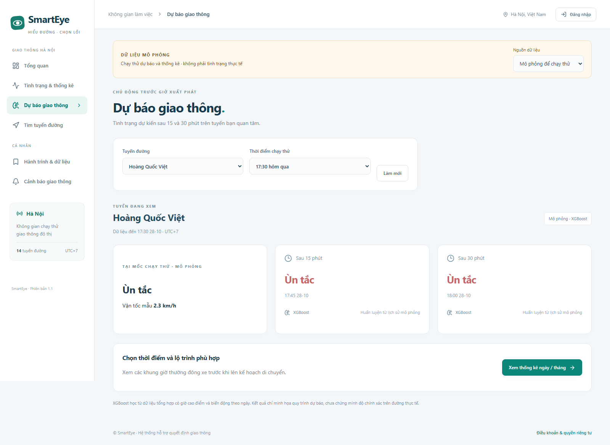

# Chạy thử dự báo mà chưa có camera

Bản này có chế độ **Mô phỏng để chạy thử**, tự chuẩn bị ở lần khởi động đầu trong môi trường development. Không cần tải video hay tự nhập hàng nghìn dòng dữ liệu.

## Chạy trên máy hiện tại

```powershell
cd C:\Users\Admin\Documents\GitHub\SmartEye
docker compose up -d --wait --wait-timeout 240
```

Mở http://localhost:8081. Ở đầu trang chọn **Mô phỏng để chạy thử**.

1. **Dự báo giao thông** → chọn Hoàng Quốc Việt hoặc tuyến khác → xem hiện tại và sau 15/30 phút.
2. Chọn **07:30 hôm qua** hoặc **17:30 hôm qua** để thử lại giờ cao điểm; các ngày/giờ trên thẻ là mốc chạy thử, không phải thời gian hiện tại.
3. **Tình trạng & thống kê** → tìm tên đường → chọn ngày/tháng → xem biểu đồ 24 giờ, khung giờ thường đông xe và bản đồ nhiệt. Bấm ô tháng để mở ngày đó.
4. **Tải CSV mẫu** để lấy dữ liệu ra làm báo cáo. CSV ghi rõ `source=synthetic`.
5. **Tìm tuyến đường** → nhập địa chỉ và chọn kết quả hoặc ghim A/B → chọn ưu tiên thời gian/khoảng cách. Tình trạng mô phỏng chỉ điều chỉnh ETA trên phần tuyến trùng tên các đường mẫu; những phần khác chưa có dữ liệu.
6. Đổi nguồn sang **Quan sát thực tế** để kiểm tra trạng thái thiếu dữ liệu. Mẫu mô phỏng không được đưa vào bảng quan sát thực hay tự kích hoạt mô hình thực.

Dừng bằng `docker compose stop`, chạy lại bằng `docker compose up -d`. Không cần tạo lại dữ liệu mỗi lần.

## Tạo hoặc huấn luyện lại

Docker:

```powershell
docker compose exec backend python scripts/prepare_demo.py --days 31
Invoke-RestMethod http://localhost:8081/api/demo/status
```

Local, sau khi MongoDB và `.env` đã đúng:

```powershell
.venv\Scripts\python.exe -m pip install -r backend/requirements.txt
.venv\Scripts\python.exe scripts/prepare_demo.py --days 31
```

Hoặc Admin vào Dự báo, nếu chưa có mẫu thì bấm **Tạo dữ liệu mẫu**. Huấn luyện chạy nền; dữ liệu cũ tiếp tục dùng đến khi bộ mới hoàn tất. Khi đã sẵn sàng, script có thể tạo lại bộ mẫu mà không xóa dữ liệu thực.

Backend và frontend chạy local theo [RUNNING.md](RUNNING.md). Không cần `download_model.py` để dùng dự báo mới.

## Dữ liệu được tạo như thế nào?

- Seed cố định 42, chu kỳ sáng/chiều, sự khác biệt từng đường, cuối tuần và nhiễu có tương quan theo thời gian. Thỉnh thoảng có một đợt đông xe ngoài giờ cao điểm.
- Mỗi 5 phút có chỉ số mật độ, số xe minh họa, tốc độ mẫu và nhãn FREE / SLOW / JAM. Nhãn mô phỏng dựa trên tỷ lệ tốc độ mẫu / tốc độ thông thoáng: dưới 0,30 là JAM, dưới 0,65 là SLOW, còn lại FREE. Đây là quy ước của bộ sinh, không phải tiêu chuẩn đánh giá giao thông thực.
- Tạo 31 ngày trước cùng ngày hiện tại cho tối đa 20 tuyến đang hoạt động, gồm Hoàng Quốc Việt. Nếu tuyến mẫu này chưa có, chỉ thêm bản ghi mới có `is_demo=true`; không sửa tuyến của bạn.
- XGBoost học từ 8 ngày trước, dùng 12 mốc lịch sử liên tiếp (60 phút), số xe, chỉ số/nhãn lịch sử, giờ, thứ và mã tuyến. Ngày hiện tại không tham gia huấn luyện.
- Hai mô hình cho 15 và 30 phút. Chia 60/20/20 theo thời gian; nhãn train/validation phải nằm trước phần kế tiếp. Chuẩn hóa chỉ fit trên train. Có báo cáo so với cách giữ nguyên trạng thái.
- Lúc dự báo chỉ đọc mốc đến thời điểm yêu cầu; không lấy nhãn tương lai từ bộ sinh để trả thay mô hình. Không coi điểm tốt trên dữ liệu tổng hợp là độ chính xác trên đường thật.
- Các ngày bị bỏ lỡ khi máy tắt được sinh bù trong cửa sổ 31 ngày khi xem báo cáo. Phần tương lai của ngày/tháng vẫn trống.

## Lưu ở đâu?

| Nơi lưu | Nội dung |
|---|---|
| MongoDB `demo_profiles` | Các mốc 5 phút được nhóm theo ngày và đường; có `source=synthetic`, mã bộ dữ liệu riêng |
| MongoDB `demo_registry` | Bộ mẫu đang dùng và trạng thái chuẩn bị |
| `backend/data/demo-forecasts/<UUID>/` | Hai mô hình XGBoost và metadata đánh giá |

Không ghi mẫu vào `observations`, `traffic_samples`, `traffic_labels`, `forecast_runs` hay `forecast_registry`. Dữ liệu/tài khoản cũ và các video lưu trữ được giữ nguyên. Compass kết nối MongoDB Docker qua **127.0.0.1:27018** bằng tài khoản database trong `.env` rồi mở DB theo `MONGODB_DB`; 27017 có thể là một server khác.

## Cấu hình và API

- `DEMO_DATA_ENABLED`: mặc định bật ở development, tắt ở production; chỉ bật ở production nếu chủ ý triển khai một bản demo có nhãn.
- `DEMO_AUTO_PREPARE=true`, `DEMO_HISTORY_DAYS=31`, `DEMO_ESTIMATORS=96`.
- `VIDEO_FEATURE_ENABLED=false`: không tải video mới. Chỉ bật lại nếu cần kiểm tra tương thích API cũ; giao diện nhận diện đã gỡ.
- `OSRM_URL=https://router.project-osrm.org`: nguồn ô tô nhanh; cache ứng viên 10 phút, trọng số và dữ liệu giao thông được tính lại theo từng yêu cầu. Xe máy dùng mạng OSM đầy đủ; không thay bằng tuyến xe đạp hay tuyến ô tô không kiểm tra quyền.
- `GET /api/demo/status`, `GET /api/demo/predict?segment_id=14`.
- `GET /api/demo/predict?segment_id=14&issue_at=<ISO có múi giờ trong 30 ngày đã qua>`.
- `GET /api/demo/history?segment_id=14&period=month&value=2026-10` (thay ID/tháng bằng dữ liệu của bạn).
- `GET /api/demo/export.csv?segment_id=14`.
- `POST /api/demo/prepare` chỉ Admin; không cần gửi body.
- `GET /api/bootstrap?data_mode=demo` khởi tạo trang bằng một request.
- `POST /api/routes/search` có `provider=auto`, `algorithm=astar`, `traffic_mode=demo|observed`. Ô tô mặc định xếp hạng các ứng viên OSRM; `provider=demo|osm` dùng đồ thị đầy đủ và A*, còn `algorithm=compare` chỉ phục vụ kiểm chứng qua API.

## Khi cần dữ liệu thật

Giữ dữ liệu mẫu để thử giao diện. Với nghiên cứu chính thức, dùng CSV quan trắc được phép sử dụng hoặc dữ liệu mở có thời gian/địa điểm rõ ràng; Quản lý/Admin nhập lịch sử và nhãn đã kiểm chứng trong **Dữ liệu & mô hình**, huấn luyện rồi đánh giá trước khi kích hoạt. Không nhập CSV tổng hợp vào chế độ thực và gọi nó là dữ liệu thu thập tại Hà Nội. Pipeline GRU và XGBoost cho dữ liệu thực vẫn có tại [FORECASTING.md](FORECASTING.md).

## Ảnh từ Docker sau cập nhật

Các ảnh dưới đây dùng bộ dữ liệu mô phỏng riêng trong Docker, không phải camera hay tình trạng thực của Hà Nội.



[Dự báo trên điện thoại](previews/forecast-demo-mobile.png) · [Thống kê tháng trên máy tính](previews/traffic-demo-desktop.png) · [Thống kê tháng trên điện thoại](previews/traffic-demo-mobile.png).
