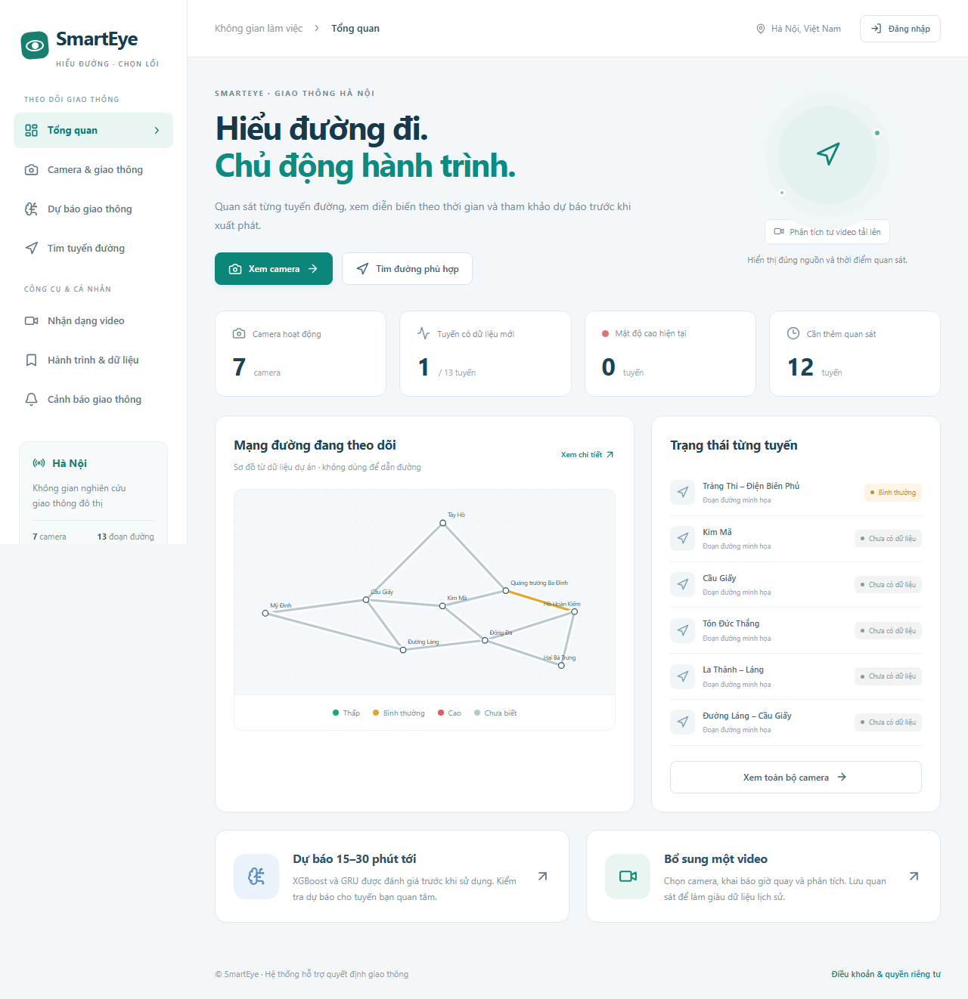

# Pipeline XGBoost / GRU trên dữ liệu quan sát thực

**Luồng mới có tốc độ, lưu lượng, mật độ theo chiều dài, CI, xác suất và đối chiếu kết quả:** xem [quy trình sáu bước và hướng dẫn huấn luyện](TRAFFIC-PIPELINE.md). Trong Dữ liệu & mô hình chọn **Tình trạng, xác suất và tốc độ từ quan trắc 5 phút**. Luồng này bổ sung mốc 60 phút, hiệu chỉnh xác suất trên tập riêng và hồi quy tốc độ; phần XGBoost/GRU bên dưới giữ cho hai mục tiêu cũ.

Admin mở **Quản trị hệ thống → Dữ liệu & mô hình**. Quản lý mở **Giám sát & xử lý → Dữ liệu & thiết lập → Dữ liệu & mô hình** khi được cấp quyền. Các tuyến và thao tác của Quản lý giới hạn theo phạm vi được giao. Bản chạy thử có mô hình XGBoost học từ dữ liệu minh họa được lưu riêng. [Dữ liệu minh họa](DEMO.md)



Ảnh giao diện lấy từ kiểm thử trình duyệt, dùng mạng đường demo công khai và DB kiểm thử riêng. Không phải kết quả dự báo giao thông Hà Nội. [Màn hình quản lý mô hình](previews/forecast-management.png) · [Giao diện điện thoại](previews/forecast-mobile.png).

Phần dự báo ngày/giờ và lịch sử một năm: [PLANNING.md](PLANNING.md). Tài liệu bên dưới dành cho quản lý mô hình quan sát thực.

## Sử dụng

Trang **Tổng quan** là điểm bắt đầu: Tình trạng & thống kê, Dự báo và Tìm đường. Nhận diện video đã được gỡ khỏi giao diện. Menu giữ đường dẫn bằng hash nên tải lại hoặc dùng nút Back vẫn về đúng màn hình.

1. Cập nhật và chạy Docker theo `docs/RUNNING.md`. Sau thay đổi này cần build **backend** để có `xgboost-cpu` và `scikit-learn`; PyTorch CPU đã có trong Dockerfile. Không cần cài TensorFlow.
2. Mở `http://localhost:8081/#forecast` nếu `.env` đang dùng `FRONTEND_PORT=8081`.
3. Người dùng gõ tên đường, chọn ngày và khung giờ trên trang **Dự báo giao thông**. Mốc 15/30 phút của XGBoost và GRU thuộc luồng mô hình kỹ thuật bên dưới.
4. Admin hoặc Quản lý có quyền chuẩn bị dữ liệu mở **Dữ liệu & mô hình** trong không gian tương ứng, chọn tuyến và khoảng thời gian, rồi bấm **Kiểm tra dữ liệu**.
5. Khi đủ dữ liệu, bấm **Huấn luyện XGBoost + GRU**. Một worker huấn luyện nền; có tiến độ và thao tác hủy. Chỉ một tác vụ chạy tại một thời điểm. Khởi động lại máy chủ sẽ đánh dấu tác vụ gián đoạn là thất bại, không tự phục hồi kết quả dở dang.
6. Xem bảng so sánh XGBoost / GRU / Giữ nguyên trạng thái, điểm validation, ma trận nhầm lẫn và tải CSV báo cáo.
7. **Admin hoặc Quản lý phụ trách toàn bộ tuyến** có quyền mô hình kích hoạt bản đủ điều kiện. Mỗi mục tiêu có một bản đang phục vụ. Chỉ các mốc và tuyến đạt đánh giá được phép trả dự báo. Có thể kích hoạt lại một bản cũ hoặc ngừng phục vụ mà không xóa báo cáo.

Code cung cấp luồng huấn luyện thật, không kèm mô hình dự báo đã huấn luyện cho Hà Nội và không thêm số liệu tổng hợp vào các collection quan sát/nhãn/mô hình thực. Bộ mẫu nằm riêng trong `demo_profiles` và `demo_registry`.

## Đo độ chính xác của dự báo theo giờ

1. **Đoạn đường**. Khai báo tuyến, tỉnh/thành, vị trí và chiều lưu thông để chọn đúng nơi cần dự báo.
2. **Nguồn dữ liệu**. Nhập dữ liệu quan trắc đã xác nhận tình trạng `FREE`, `SLOW`, `JAM` theo tuyến và chiều. Có thể dùng tệp nguồn đã kiểm tra hoặc nhập CSV nhãn đã xác minh cho chiều đi trong **Dữ liệu & mô hình**. Mật độ hoặc số xe riêng lẻ chưa đủ để gán nhãn ùn tắc. Mỗi giờ cần ít nhất sáu ô năm phút khác nhau, với tối thiểu ba ô ở mỗi nửa giờ.
3. **Đánh giá dự báo theo giờ**. Quản lý mở **Giám sát & xử lý → Báo cáo theo giờ**. Chọn tuyến, chiều và ngày cuối. Bản kiểm tra chấm trên 28 ngày quan trắc và dùng tối đa 100 ngày trước mỗi ngày cần chấm. Nó so sánh với cách lấy trạng thái của ngày tương tự gần nhất. Có thể cần đến 128 ngày dữ liệu để bao phủ trọn cả lịch sử và kỳ đánh giá. Giờ thiếu căn cứ được báo riêng qua tỷ lệ số giờ đã chấm trên số giờ có nhãn.
4. **Đọc kết quả**. Muốn ghi 80–90% trong báo cáo, lấy tỷ lệ đúng trên những giờ quan trắc thực đã chấm, ghi kèm số mẫu, Macro-F1 và tỷ lệ phát hiện đúng giờ ùn tắc. Nếu đa số giờ thông thoáng, tỷ lệ đúng chung có thể cao trong khi khả năng phát hiện ùn tắc thấp. Giữ một giai đoạn mới để đánh giá lại sau khi điều chỉnh cách dự báo. [Cách tính độ chính xác cân bằng theo lớp](https://scikit-learn.org/stable/modules/generated/sklearn.metrics.balanced_accuracy_score.html)

Màn hình theo ngày và giờ dùng mẫu lặp từ lịch sử quan trắc khi đủ dữ liệu. Hai mô hình XGBoost và GRU cho mốc 15/30 phút sử dụng quy trình huấn luyện riêng ở phần dưới. Chỉ tiêu 80–90% cần được xác nhận riêng cho từng bài toán, tuyến và chiều.

## Căn cứ dự báo đang dùng

Màn hình chọn ngày và giờ ưu tiên lịch sử quan trắc của đúng đoạn đường, chiều đi và khung giờ. Hệ thống xét 100 ngày trước, nhóm ngày làm việc hoặc cuối tuần giống ngày cần dự báo, rồi chọn trạng thái xuất hiện nhiều nhất. Cần ít nhất 5 ngày phù hợp có dữ liệu đạt yêu cầu. Nhánh này đang dùng mẫu lặp trong lịch sử, chưa kết hợp lượng xe hiện tại vào một mô hình AI.

Bộ mẫu một năm phục vụ chạy thử có XGBoost cho ngày tương lai. Đầu vào gồm giờ, thứ, chu kỳ trong năm, mã tuyến và các chỉ số của cùng giờ cách 7, 14, 21, 28 ngày. Các chỉ số lịch sử gồm mật độ, tỷ lệ ô ùn tắc, tốc độ và số xe. Kết quả từ bộ mẫu được gắn nhãn minh họa.

Pipeline XGBoost và GRU trên dữ liệu thực ở tài liệu này giải quyết mốc 15 và 30 phút. Nó lấy 60 phút quan sát vừa qua cùng giờ, thứ và mã tuyến. Số xe, mật độ và tỷ lệ quan sát cao/thấp hiện có trong đặc trưng. Vận tốc và lưu lượng theo phút chưa phải đầu vào của pipeline này. Nhãn ùn tắc cần căn cứ thực tế độc lập.

Tỷ lệ 18 ngày ùn tắc trên 20 ngày phù hợp tương đương tần suất lịch sử 90%. API trả tỷ lệ này qua `jam_frequency`. Tỷ lệ đó mô tả tập lịch sử đã quan sát. Để công bố xác suất ùn tắc 90% cho một dự báo mới, cần kiểm tra khả năng hiệu chỉnh xác suất trên dữ liệu thực tách riêng theo thời gian. Độ chính xác của mô hình được đo bằng việc đối chiếu các dự báo với tình trạng xảy ra sau đó, kèm số mẫu, Macro-F1 và khả năng phát hiện đúng giờ ùn tắc.

## Chuẩn bị dữ liệu

- Nhập CSV có thời gian và nguồn quan sát đã được phép sử dụng. Dữ liệu video đã công bố từ bản cũ vẫn được đọc; màn hình tải video mới đã gỡ.
- Hoặc Admin hay Quản lý có quyền `models.manage` nhập CSV số liệu đã quan sát. Quản lý chỉ nhập cho tuyến được phân công. Tải mẫu tiêu đề ở `database/templates/traffic-observations.csv`. Các cột bắt buộc: `segment_id,observed_at,score,count,density`.
- Thời gian là ISO có múi giờ; score 0–1, count 0–10000, density LOW/NORMAL/HIGH. Mỗi dòng là một quan sát thật, không phải một hàng đại diện do hệ thống tự nhân lên.
- CSV tối đa 2 MB/5.000 dòng. **Kiểm tra CSV** không ghi DB; **Xác nhận nhập** mới ghi. Tất cả hàng được kiểm tra trước khi ghi. Nhập lại cùng tuyến/thời điểm bỏ qua bản đã có, không ghi đè. MongoDB không có transaction nhiều document: lỗi giữa lúc ghi có thể để lại một phần; nhập lại an toàn nhờ sample_key unique.
- CSV chỉ nhập mẫu mật độ; không tự tạo nhãn ùn tắc.

Ví dụ định dạng (minh họa cấu trúc, không phải dữ liệu thực):

```csv
segment_id,observed_at,score,count,density
1,2026-01-15T07:01:00+07:00,0.40,12,NORMAL
```

Đối với mục tiêu **ùn tắc**, Admin hoặc Quản lý có quyền `models.manage` xác nhận nhãn FREE/SLOW/JAM sau khi xem căn cứ thực tế. Quản lý chỉ xác nhận cho tuyến được phân công. Mốc nhãn là **kết thúc ô 5 phút**: nhãn 07:05 mô tả ô 07:00–07:05. Có tên người xác nhận, căn cứ và nhật ký. API không chấp nhận nhãn tương lai hoặc mốc không chia hết 5 phút. Có thể nhập hàng loạt bằng CSV nhãn riêng (`segment_id,observed_at,state,note`), kiểm tra trước rồi xác nhận nhập. Mốc đã có được cập nhật và gắn người nhập hiện tại; không sinh mẫu mật độ. Có thể sửa nhãn; bộ dữ liệu của các lần huấn luyện đã lưu giữ nguyên để truy vết.

## Cửa sổ và đặc trưng

- Chuẩn hóa từng camera/ô 5 phút, lấy mức cao nhất trên đoạn đường như thống kê lịch sử.
- Một ô dùng cho ML cần quan sát ở ít nhất **3 phút khác nhau**, đã kết thúc; một khung hình không đủ đại diện cho cả ô.
- Cần **12 ô liên tiếp (60 phút)**. Khoảng trống không được thay bằng 0 hoặc điền từ tương lai.
- Đặc trưng từng bước: chỉ số mật độ, log(1+số xe), cờ mật độ cao/thấp, sin/cos giờ và thứ UTC+7, mã tuyến one-hot.
- XGBoost nhận cửa sổ làm vector; GRU nhận ma trận 12 bước × số đặc trưng. Chuẩn hóa chỉ fit trên train, sau đó áp nguyên tham số cho validation/test/inference.
- Nhãn dự báo nằm đúng mốc kết thúc ô ở t+15 hoặc t+30. Mục tiêu mật độ dùng mức đã hiệu chỉnh camera; mục tiêu ùn tắc dùng nhãn thực tế độc lập. Persistence dùng nhãn tại t; mục tiêu ùn tắc cần có nhãn cả t và t+h để so sánh công bằng.

## Huấn luyện và đánh giá

Mỗi mốc có một XGBoost classifier và một GRU classifier ba lớp. XGBoost dùng cây tăng cường histogram/CPU, dừng sớm trên validation. GRU một lớp 32 hidden units, đầu ra tuyến tính ba lớp, weighted cross entropy, Adam và dừng sớm trên validation. Seed 42; GRU mặc định tối đa 25 epoch. Không dùng kết quả định tuyến Google làm dữ liệu huấn luyện.

Điều kiện thử nghiệm ban đầu: ít nhất 7 ngày khác nhau, 180 cửa sổ mỗi mốc; train có tối thiểu 10 ví dụ mỗi lớp, mỗi phần dữ liệu có ít nhất 25 cửa sổ. Khoảng truy vấn tối đa 300.000 mẫu/quan sát, 40.000 cửa sổ/mốc và 20 tuyến. Đây là giới hạn vận hành và sàng lọc ban đầu, không chứng minh đủ đại diện cho mọi điều kiện giao thông.

Chia theo mốc thời gian chung giữa các tuyến: train / validation / test khoảng 60 / 20 / 20. Nhãn train phải xảy ra **trước** thời điểm bắt đầu validation; tương tự validation/test. Không shuffle các phần dữ liệu qua thời gian. Shuffle mini-batch chỉ nằm trong tập train.

Mô hình thắng được chọn bằng Macro-F1 trên **validation**. Báo cáo test có Macro-F1, accuracy, recall lớp cao/ùn tắc, số mẫu từng lớp và ma trận nhầm lẫn; giữ cả kết quả hai mô hình và baseline. Có báo cáo theo từng tuyến.

Điều kiện kích hoạt ban đầu:

- Validation F1 hơn Persistence ít nhất 0,01.
- Test F1 tối thiểu 0,45 và không thấp hơn Persistence.
- Recall lớp cao/ùn tắc trên test ít nhất 0,5; mỗi lớp test có ít nhất 5 ví dụ.
- Từng tuyến được phục vụ cũng phải đủ số mẫu và vượt baseline trên validation, không thấp hơn baseline trên test; tuyến không đạt bị loại khỏi phạm vi phục vụ.

Đây là ngưỡng kiểm soát sản phẩm, không phải kết luận khoa học về độ chính xác thực địa. Phải tiếp tục theo dõi hiệu năng trên dữ liệu mới; test đã xem không được sử dụng để tinh chỉnh nhiều lần rồi coi là tập kiểm thử độc lập.

## Phục vụ dự báo và tìm đường

Dự báo dùng mô hình đã được Admin hoặc Quản lý có quyền kích hoạt. Mô hình cần có tệp đầy đủ, đúng tuyến và đúng mục tiêu. Cần 60 phút dữ liệu liên tiếp đủ chất lượng; ô mới nhất kết thúc không quá 10 phút trước. Mô hình có khoảng dữ liệu huấn luyện kết thúc quá 45 ngày cần huấn luyện lại. Không hiển thị tỷ lệ “chắc chắn tắc” chưa được hiệu chỉnh xác suất.

Với tìm tuyến khởi hành trong tương lai, dự báo chỉ được ghép khi thời điểm dự báo lệch giờ khởi hành tối đa 2,5 phút, trong phạm vi 35 phút tới. Ưu tiên mô hình ùn tắc nếu có, sau đó mật độ; thiếu dự báo thì dùng lịch sử đủ bằng chứng. Quan sát hiện tại vẫn phục vụ tìm tuyến ngay bây giờ. Camera/dự báo chỉ bổ sung rủi ro, giữ ETA của Google. Đây chưa phải mô hình dự báo theo thời điểm đến từng cạnh của tuyến.

## Database và tệp

Ba collection mới: `forecast_runs` (tác vụ/báo cáo), `traffic_labels` (nhãn độc lập), `forecast_registry` (bản kích hoạt theo mục tiêu). Startup tạo collection/index mới, không xóa dữ liệu cũ. Tổng cộng 15 collection nghiệp vụ + counters.

`backend/data/forecasts/<uuid>/` lưu snapshot NPZ, XGBoost JSON, GRU state_dict và metadata. Không có endpoint cho tải pickle hoặc nạp model do người dùng gửi lên. GRU chỉ load state_dict bằng `weights_only=True`. Tệp huấn luyện và mô hình không được commit GitHub. Thư mục có thể tăng theo các lần huấn luyện; tác vụ đã hủy có thể còn tệp dở dang, cần dọn theo chính sách lưu trữ khi vận hành lâu dài.

## API

| API | Quyền |
|---|---|
| GET `/api/forecast/status`, GET `/api/forecast/predict?segment_id=1&target=density` | Dự báo đã kích hoạt theo quyền xem dự báo, metadata còn hỗ trợ quyền quản lý mô hình |
| POST `/api/forecast/readiness`, GET/POST `/api/forecast/runs` | Admin hoặc Quản lý có quyền `models.manage` trong phạm vi được phân công |
| POST `/api/forecast/runs/{uuid}/cancel` | Admin hoặc Quản lý có quyền `models.manage`, phụ trách toàn bộ các tuyến của tác vụ |
| POST `/api/forecast/runs/{uuid}/activate`, DELETE `/api/forecast/active/{target}` | Admin hoặc Quản lý toàn bộ tuyến có quyền `models.manage` |
| GET `/api/forecast/runs/{uuid}/report.csv` | Admin hoặc Quản lý có quyền `models.manage` trong phạm vi được phân công |
| GET/POST `/api/forecast/labels`, POST `/api/forecast/labels/import?dry_run=true/false` | Admin hoặc Quản lý có quyền `models.manage` trong phạm vi được phân công |
| POST `/api/forecast/import?dry_run=true/false` | Admin hoặc Quản lý có quyền `models.manage` trong phạm vi được phân công |

## Chạy sau cập nhật

```powershell
cd C:\Users\Admin\Documents\GitHub\SmartEye
docker compose up --build -d --wait
```

Mở cổng frontend theo `.env` (máy hiện dùng 8081). Lần sau chỉ cần `docker compose up -d --wait`. Ổ chứa Docker cần đủ chỗ cho các lớp image và quá trình giải nén. Không cần chạy lại seed tài khoản hoặc nhập fixture DB khi nâng cấp.
