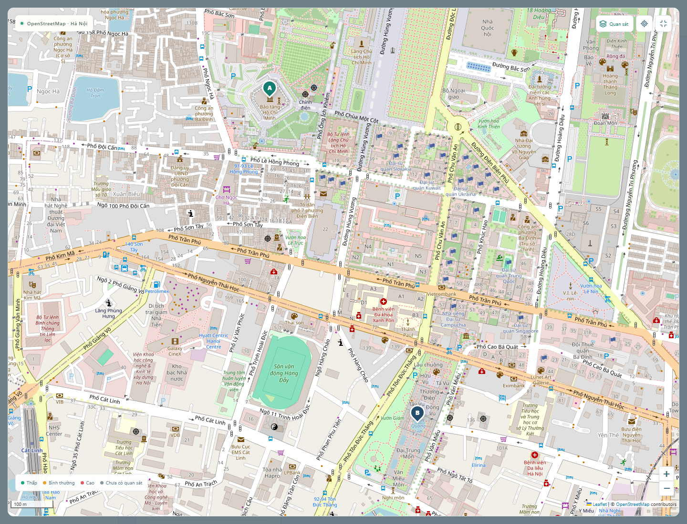

# Bản đồ đường phố và địa chỉ OpenStreetMap



Ảnh chụp nền OpenStreetMap thật và ghim hai địa danh công cộng, không có tuyến/traffic được tạo giả. [Giao diện nhập địa chỉ với kết quả Photon thật](previews/osm-address-live.png).

SmartEye dùng Leaflet để hiển thị nền OpenStreetMap có tên đường, ngõ và công trình theo độ phủ dữ liệu. Kéo, pinch trên điện thoại, nút +/− và nút mở rộng bản đồ hoạt động mà không cần Google API key. Nền bản đồ khác với dữ liệu quan sát giao thông: đường hiện rõ không đồng nghĩa đã có camera hoặc tốc độ trực tiếp.

## Cập nhật và chạy

Trong PowerShell ở thư mục dự án, sau khi Docker Engine đã hoạt động và đủ dung lượng build:

```powershell
git pull origin main
docker compose up --build -d --wait --wait-timeout 240
docker compose ps
```

Mở `http://localhost:8081/#routes` nếu `.env` dùng `FRONTEND_PORT=8081`. Frontend/backend cần build lại. Không cần tạo lại database, đổi mật khẩu hoặc chạy lại script setup_env chỉ để bật OSM. Các biến mới có giá trị mặc định khi `.env` cũ chưa chứa chúng.

Chạy native: `npm ci` để thêm Leaflet, sau đó chạy backend/frontend như RUNNING.md; không có dependency Python mới.

## Nhập điểm đi và đến

1. Chọn **OpenStreetMap · đường phố thực**. Đây là nguồn mặc định của giao diện mới.
2. Nhập số nhà, ngõ, tên đường, phường và Hà Nội vào từng ô. Chờ gợi ý hoặc bấm nút tìm.
3. Chọn một kết quả; ghim A/B xuất hiện và địa chỉ đã chọn được hiển thị đầy đủ bên dưới ô. Chưa chọn kết quả thì không gửi tuyến dựa trên nội dung đang gõ.
4. Kiểm tra ghim. Kết quả ghi rõ có số nhà, vị trí đường hoặc địa điểm. Nguồn địa chỉ có thể thiếu/sai số nhà, dùng tên tiếng Anh hoặc chỉ xác định vị trí một con đường.
5. Nếu cần, bấm **Chọn trên bản đồ** bên dưới ô và chạm đúng lối ra vào mong muốn. Ghim trực tiếp không cần dịch vụ tìm địa chỉ. Hai điểm hiện hỗ trợ trong khu vực tọa độ Hà Nội đã giới hạn của dự án.
6. Chọn ô tô/xe máy, giờ khởi hành, trọng số và Dijkstra/A*/So sánh; bấm **Tìm tuyến tối ưu**.

Đổi chiều sẽ đổi cả tọa độ và địa chỉ. Sửa nội dung đã chọn làm mất xác nhận của ô đó; người dùng phải chọn lại kết quả/ghim. Khi lưu yêu thích, lưu hai tọa độ, tên đầy đủ, nguồn định tuyến và ưu tiên; tuyến/ETA được tính mới khi mở lại.

## Đồ thị đường thực

Backend tải đường OSM qua Overpass trong một vùng bao hai điểm có phần đệm, giữ hình học từng đường. Mạng đường này độc lập với 13 cạnh minh họa trong MongoDB. Có giới hạn ban đầu: hai điểm cách nhau không quá 20 km đường chim bay, diện tích vùng không quá 0,07 độ vuông, 120.000 phần tử nguồn và 100.000 cạnh đồ thị trạng thái. Đây không phải cam kết định tuyến toàn bộ Hà Nội.

Đồ thị giữ nút OSM để tránh tự nối hai đường chỉ vì chúng cắt nhau trên ảnh, ví dụ cầu vượt. Các nút hình học bên trong cùng đường được nén nhưng vẫn giữ polyline và tổng chiều dài Haversine. Quy tắc đang có:

- Chiều `oneway=yes/no/-1`, đường vòng và các thẻ một chiều riêng cho phương tiện.
- Quyền access theo phương tiện, đường riêng/cấm, đường chỉ đến điểm cuối; xe máy không được tự đưa vào motorway/trunk/motorroad.
- Thẻ bề rộng có sẵn: mặc định bỏ đường dưới 2,2 m cho ô tô và dưới 0,8 m cho xe máy. Thiếu thẻ không chứng minh xe thực tế đi được.
- Rào chắn được xử lý thận trọng khi không có quyền đi được gắn rõ.
- Hạn chế rẽ `no_*`/`only_*` qua một nút, có xét phương tiện/ngoại lệ. Trạng thái tìm kiếm giữ cạnh vừa đi vào để xử lý rẽ; `no_u_turn` không cấm tiếp tục đi thẳng cùng đường.
- Hạn chế qua chuỗi đường hoặc theo điều kiện chưa hỗ trợ được loại thận trọng ở đường đi vào, thay vì bỏ qua và cho phép rẽ. Vì vậy có thể bỏ mất một tuyến hợp lệ hoặc không tìm được tuyến.

Ghim được chiếu lên đoạn đường phù hợp gần nhất, cách tối đa 200 m. Ghim xa hơn bị từ chối và yêu cầu kiểm tra lại lối ra vào. Response/GUI hiển thị độ lệch. Polyline, tổng km và ETA là phần tuyến trên mạng đường; đoạn từ cửa nhà tới điểm nối chưa được xác minh và không được cộng như một đường lái xe xuyên qua nhà.

## Thời gian, mật độ và tính tối ưu

ETA dùng vận tốc tham chiếu theo loại đường, phương tiện, thẻ giới hạn tốc độ nếu có. Nếu đoạn khảo sát thật (không phải demo) có quan sát/dự báo/lịch sử phù hợp và khớp hình học trong 40 m, dùng mức mật độ để điều chỉnh vận tốc tham chiếu và chi phí rủi ro. Chưa có dữ liệu thì giữ `density=null`, `unknown_share`, không tô thành đường thông thoáng và không dùng quan sát demo để sửa ETA OSM.

Không đo tốc độ trực tiếp từ YOLO. Không có traffic feed toàn thành phố; ùn tắc/sự cố/biển cấm hoặc điều kiện mới chưa có trên nguồn dữ liệu có thể không được phản ánh. Khi xét tương lai, chi phí vẫn là snapshot theo giờ khởi hành, chưa tính lại theo thời điểm đến từng đoạn.

Dijkstra và A* tối ưu cùng hàm chuẩn hóa thời gian + khoảng cách (+ phạt rủi ro tùy chọn) như ROUTING.md, với cùng snapshot. T0/D0 được tính trên cùng đồ thị trạng thái có hạn chế rẽ. Đối chiếu kiểm tra hai chi phí tối ưu bằng nhau trong sai số số học. Response ghi `scope=osm_network`: tối ưu trong mạng đường được tải và được bộ quy tắc hiện tại cho phép, không khẳng định tối ưu toàn bộ mạng đường ngoài phạm vi đó.

Tuyến thay thế dùng Yen với ngân sách 48 lượt tìm nhánh; giữ tối đa ba phương án, bỏ vòng lặp không cần thiết trong phương án phụ. Không cam kết đây là ba tuyến xếp đầu toàn mạng khi ngân sách đã giới hạn. Tuyến chính vẫn được tìm bằng Dijkstra/A* đầy đủ trên đồ thị đã dựng.

## Dịch vụ và cấu hình

Các biến tùy chọn đã có trong `.env.example`:

```dotenv
OSM_ENABLED=true
OSM_TILE_URL=https://tile.openstreetmap.org/{z}/{x}/{y}.png
PHOTON_URL=https://photon.komoot.io
OVERPASS_URL=https://overpass-api.de/api/interpreter
OVERPASS_FALLBACK_URL=https://overpass.private.coffee/api/interpreter
OSM_USER_AGENT=SmartEye/1.0 (+https://github.com/nguyenbaolong2504/SmartEye)
```

- Tile tải trực tiếp trong trình duyệt, giữ attribution và chính sách cache mặc định; không tải hàng loạt/prefetch. Xem [OSM tile policy](https://operations.osmfoundation.org/policies/tiles/).
- Địa chỉ dùng [Photon](https://github.com/komoot/photon), hỗ trợ search-as-you-type. Debounce 650 ms, hủy kết quả cũ, giới hạn API 45/min/IP, giãn các lượt upstream và cache 5 phút trong bộ nhớ (tối đa 256 truy vấn). Không gọi public Nominatim cho autocomplete.
- Đường tải theo nhu cầu từ [Overpass](https://dev.overpass-api.de/overpass-doc/en/preface/commons.html), tối đa một lượt tải cùng lúc, giãn lượt, có fallback một nguồn. Cache gzip dữ liệu đường công khai ở `backend/data/osm-cache`, hạn 6 giờ, tối đa 8 vùng. Cache không chứa truy vấn địa chỉ/tài khoản.
- Photon và Overpass công cộng phục vụ theo khả năng, có thể giới hạn hoặc quá tải. Khi không tải được đường, hệ thống giữ ghim, báo lỗi và không thay bằng tuyến thẳng/seed demo. Ghim thủ công vẫn cần nguồn đường để tính tuyến lần đầu. Triển khai nhiều người dùng nên chuyển các URL sang nguồn riêng/phù hợp dung lượng.

Nội dung địa chỉ gửi tới Photon; vùng tọa độ gửi tới nguồn Overpass. Attribution OSM/ODbL luôn hiện trên bản đồ. Google Routes vẫn dùng Google Maps khi được cấu hình, không đặt nội dung Google lên nền OSM. Mạng đoạn đường dự án vẫn là lựa chọn riêng cho các luồng khảo sát/demo cũ.

## Kiểm chứng

Backend có fixture mạng đường riêng cho kiểm tra snap giữa cạnh, chiều đường, quyền xe, bề rộng, cấm rẽ, tiếp tục qua nút khi cấm quay đầu, tránh dữ liệu demo, tác động quan sát thật, lỗi upstream, fallback/cache và đối chiếu hai thuật toán. E2E dùng upstream/DB riêng để kiểm tra địa chỉ, ghim, zoom, mở rộng, lựa chọn nguồn và lưu/mở lại hành trình. Dữ liệu fixture không được đưa vào database triển khai hoặc dùng làm fallback production.

Các kết quả thật của dịch vụ và giới hạn khi kiểm tra được ghi trong [validation.md](validation.md), không suy độ chính xác giao thông thực địa từ kiểm thử phần mềm.
