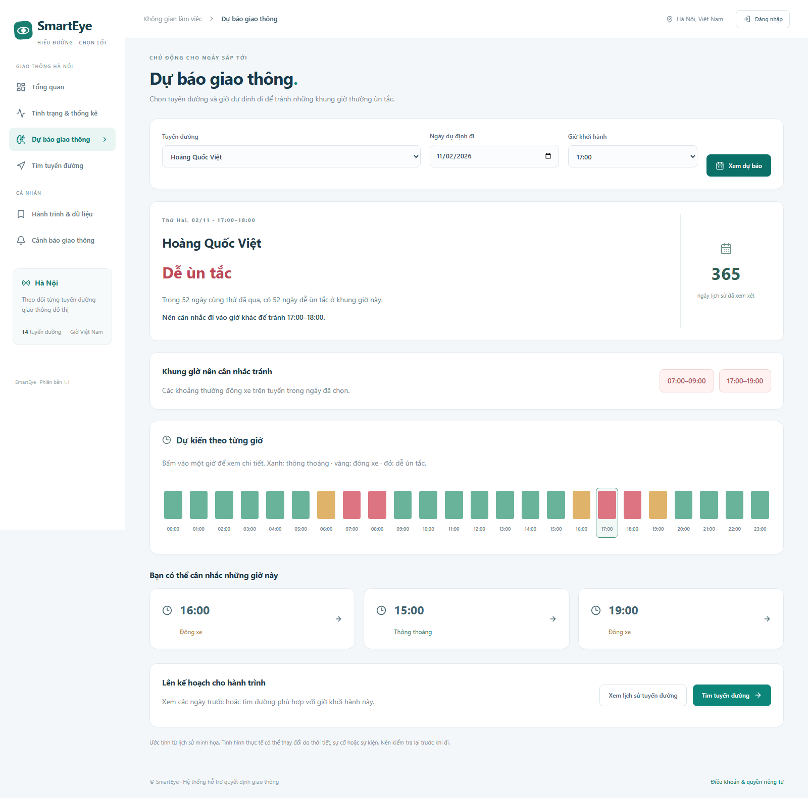

# Xem giờ nên tránh và lên kế hoạch hành trình

Bản này tập trung vào câu hỏi: **Ngày mai, đi qua tuyến đường này lúc 17 giờ có dễ ùn tắc không? Có thể đi vào giờ nào thuận tiện hơn?**

## Cách dùng

1. Mở **Dự báo giao thông**.
2. Chọn tuyến đường, ngày và giờ định đi. Mặc định là ngày mai lúc 17:00; hỗ trợ các ngày trong một tuần tới.
3. Bấm **Xem dự báo**. Trang hiển thị tình trạng dự kiến, số ngày cùng thứ từng ùn tắc và những khung giờ nên cân nhắc tránh.
4. Có thể chọn một giờ khác trong dải 24 giờ hoặc các giờ được gợi ý. Đây là các giờ để cân nhắc, không bảo đảm rằng đường chắc chắn thông thoáng.
5. Bấm **Xem lịch sử tuyến đường** để xem một năm đã qua, so sánh từng tháng và giờ cao điểm theo từng thứ. Bấm cột tháng hoặc ô ngày/giờ để đi sâu vào lịch sử.
6. Bấm **Tìm tuyến đường** để giữ lại giờ dự định đi. Nhập điểm xuất phát và điểm đến, tính tuyến, rồi bấm **So sánh giờ đi** để xem giờ đã chọn và một giờ trước/sau.

Các trang người dùng đã bỏ thanh chọn nguồn phía trên và tên thuật toán/mô hình. Lịch sử minh họa chỉ được ghi chú nhỏ ở cuối nội dung liên quan. Trang hồ sơ không có thanh nguồn dữ liệu.

## Dữ liệu một năm

- Mặc định tạo 365 ngày đã qua và ngày hiện tại cho tối đa 20 đường đang hoạt động. Bản chạy hiện tại có 14 đường, gồm Hoàng Quốc Việt.
- Đây là **dữ liệu tổng hợp để minh họa**, không phải số liệu đã thu thập ở Hà Nội, cũng không phải lịch sử tải từ Google.
- Dữ liệu thay đổi theo đường, giờ, thứ, mùa, cuối tuần và các đợt đông xe bất thường. Dữ liệu thiếu hoặc thời gian chưa đến không được coi là thông thoáng.
- MongoDB `demo_profiles` lưu các ngày và tổng hợp theo giờ. `demo_registry` chọn bộ dữ liệu đang dùng. Các collection quan sát và mô hình thực được giữ riêng.
- Có bảng tổng hợp theo giờ để khi xem cả năm không cần tải hàng triệu bản ghi lên trình duyệt. Phần tạo lịch sử ghi theo từng lô nhỏ; bộ cũ tiếp tục dùng đến khi dữ liệu và mô hình mới đã hoàn tất.

Tạo lại trong Docker nếu cần:

```powershell
cd C:\Users\Admin\Documents\GitHub\SmartEye
docker compose exec backend python scripts/prepare_demo.py --days 365
```

Chỉ chạy lại khi cần thay bộ dữ liệu. Khởi động bình thường không huấn luyện lại nếu bộ một năm đang dùng còn đầy đủ.

## Dự báo dùng lịch sử như thế nào?

Phần dự báo ngày sắp tới dùng XGBoost riêng cho từng khung giờ: học đặc điểm giờ/thứ/mùa và tình trạng cùng giờ cách 7, 14, 21, 28 ngày. Kết quả được trình bày dưới dạng thông thoáng, đông xe hoặc dễ ùn tắc. Số ngày cùng thứ từng ùn tắc là thống kê thực tế của bộ lịch sử đang dùng, không phải một phần trăm độ tin cậy do tự đặt ra.

Huấn luyện và đánh giá chia theo thứ tự thời gian; có khoảng cách một ngày giữa nhãn và phần tiếp theo. Khi phục vụ, chỉ đọc ngày đã qua, bỏ toàn bộ tổng hợp ngày hiện tại để tránh lấy cả những giờ chưa xảy ra. Không sinh ngày mai rồi lấy nhãn của ngày đó trả thay kết quả mô hình. Kiểm thử còn chèn một ngày tương lai để xác nhận nó không làm đổi dự báo.

Khi tìm đường cho giờ trong tương lai ở chế độ minh họa, các đoạn trùng đường đang theo dõi sử dụng kết quả dự báo từ lịch sử; các đoạn còn lại dùng thời gian tham chiếu của nguồn bản đồ. Không khẳng định đã có dữ liệu ùn tắc cho toàn bộ Hà Nội.

Điểm đánh giá tốt trên dữ liệu tổng hợp chưa chứng minh độ chính xác ngoài thực tế. Pipeline XGBoost/GRU từ quan sát và nhãn thực vẫn ở phần quản lý dữ liệu; pipeline ngắn hạn 15/30 phút được giữ để tương thích.

## Chuẩn bị Google Maps

Hiện dự án chưa có hai khóa nên bản chạy dùng lịch sử minh họa và bản đồ OpenStreetMap. Không có yêu cầu trả phí tới Google trong các bài kiểm thử; Google được mô phỏng bằng phản hồi hợp đồng API.

Khi có tài khoản Google Maps Platform, bật **Routes API**, **Maps JavaScript API** và thanh toán cho dự án Google. Tạo khóa máy chủ cho Routes và khóa trình duyệt cho Maps; hạn chế khóa theo dịch vụ và nơi sử dụng phù hợp. Điền trực tiếp trong `.env`, không đưa khóa bí mật lên GitHub hoặc vào chat:

```dotenv
GOOGLE_ROUTES_API_KEY=YOUR_SERVER_KEY
GOOGLE_MAPS_BROWSER_KEY=YOUR_BROWSER_KEY
```

Sau đó tạo lại container backend để đọc `.env`:

```powershell
docker compose up -d --force-recreate --no-deps backend
```

Khi có cả hai khóa, trang tìm tuyến tự dùng Google Maps. Yêu cầu gửi đúng thời điểm khởi hành và dùng `TRAFFIC_AWARE_OPTIMAL` để Google dự tính hành trình từ giao thông hiện tại/lịch sử. Bấm **So sánh giờ đi** có thể tạo tối đa ba yêu cầu dự tính tuyến cho những giờ liền kề; đây là một thao tác chủ động, không gọi định kỳ ở nền. Chi phí theo hạn mức/tài khoản Google của bạn.

Kết quả Google được đánh dấu đúng nguồn, vẽ trên Google Map, giữ thời gian dự tính của Google và không trộn với lịch sử minh họa. Không lưu polyline, kết quả hay các dự tính Google vào database, CSV hoặc mô hình học máy. Tài liệu Google mô tả dự báo tương lai dùng lịch sử; API này không phải nguồn để tải lại nguyên một năm giao thông đã qua.

Nguồn chính thức: [Dự tính giao thông và giờ khởi hành](https://developers.google.com/maps/documentation/routes/config_trade_offs), [Các lựa chọn dự tính](https://developers.google.com/maps/documentation/routes/traffic-model), [Quy định hiển thị và lưu dữ liệu](https://developers.google.com/maps/documentation/routes/policies).

## Khởi động những lần sau

```powershell
cd C:\Users\Admin\Documents\GitHub\SmartEye
docker compose up -d --wait --wait-timeout 240
```

Mở http://localhost:8081. Docker chạy cả giao diện, máy chủ và MongoDB; không cần chạy thêm terminal frontend/backend riêng. Dừng bằng `docker compose stop`. Không xóa volume database.

Các API mới: `GET /api/traffic/outlook?segment_id=<ID>&date=YYYY-MM-DD&hour=17`, `GET /api/demo/history?segment_id=<ID>&period=year`, `POST /api/routes/departures` cùng cấu trúc đầu vào với tìm tuyến.

## Hình ảnh bản đang chạy

Các ảnh dùng lịch sử minh họa, chụp trực tiếp từ Docker. Chưa dùng dữ liệu Google Maps thật.



[Trên điện thoại](previews/outlook-year-mobile.png) · [Phân tích một năm](previews/history-year-desktop.png) · [Phân tích trên điện thoại](previews/history-year-mobile.png) · [Hồ sơ đã bỏ thanh phía trên](previews/profile-clean-desktop.png).
