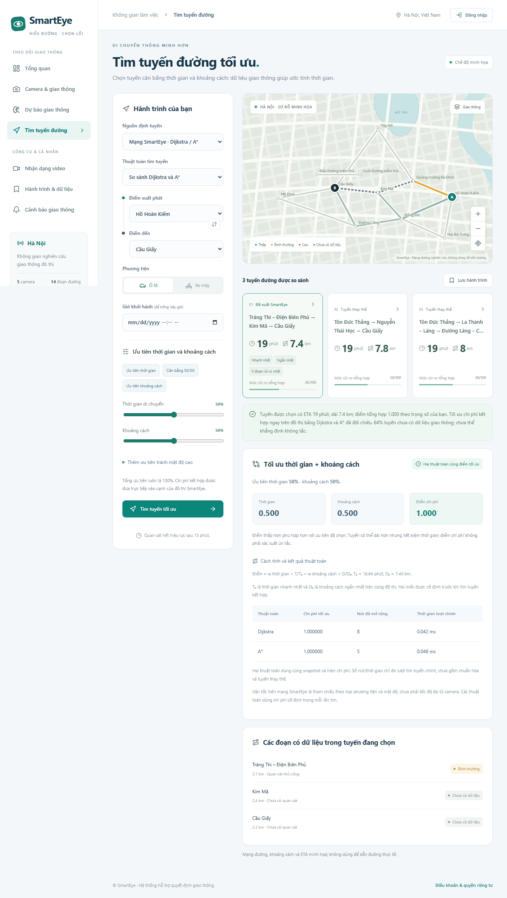

# Dijkstra / A*: tối ưu thời gian và khoảng cách

**Nguồn đường phố mới:** giao diện mặc định dùng OpenStreetMap, nhập địa chỉ và chọn ghim. Chi tiết dựng đồ thị đường thực, hạn chế rẽ, phạm vi tối ưu và ETA: [MAPS.md](MAPS.md). Phần mạng cấu hình bên dưới vẫn dành cho dữ liệu các đoạn đường trong MongoDB; Google chỉ xếp hạng tập ứng viên của nhà cung cấp.



Ảnh từ trình duyệt kiểm thử với mạng demo, không phải bằng chứng thời gian di chuyển thực tế. [Ảnh trên điện thoại](previews/routing-compare-mobile.png).

## Cách sử dụng

1. Vào **Tìm tuyến đường**, chọn **Mạng SmartEye · Dijkstra / A***.
2. Chọn điểm đi/đến, phương tiện và giờ khởi hành.
3. Chọn **So sánh Dijkstra và A*** (mặc định), hoặc chạy riêng một thuật toán.
4. Chọn ưu tiên: mặc định **60% thời gian + 40% khoảng cách**. Có nút ưu tiên thời gian, cân bằng 50/50, ưu tiên khoảng cách; các thanh tự điều chỉnh để tổng là 100%.
5. Bấm **Tìm tuyến tối ưu**. Kết quả có tối đa ba tuyến, điểm từng thành phần và bảng đối chiếu hai thuật toán.

Mục nâng cao **Thêm ưu tiên tránh mật độ cao** mặc định 0%. Mật độ đã tác động đến ETA tham chiếu; mục này bổ sung mức phạt rủi ro tích lũy theo km nếu người dùng muốn.

## Hàm mục tiêu

Tối thiểu hóa tổng chi phí cạnh, không tạo ba tuyến nhanh nhất rồi mới xếp hạng:

```text
J(P) = wt × T(P)/T0 + wd × D(P)/D0 + wr × Σ(distance_e × risk_e)/D0
```

- `T0`: thời gian nhỏ nhất có thể trên cùng đồ thị, tính bằng một lượt Dijkstra theo thời gian.
- `D0`: khoảng cách nhỏ nhất có thể trên cùng đồ thị, tính bằng một lượt Dijkstra theo km.
- Hai mốc cố định trước khi tìm tuyến kết hợp, không phụ thuộc ba tuyến được trả về.
- `wt + wd + wr = 1`; mặc định `wr = 0`. API cũng nhận bộ hai khóa time/distance và điền density=0; các favorite cũ có đủ ba khóa vẫn đọc được.
- Các chi phí hữu hạn, không âm. Trọng số âm, NaN, Infinity hoặc tất cả bằng 0 bị từ chối.
- Rủi ro quy ước LOW=0.05, NORMAL=0.35, HIGH=1, thiếu dữ liệu=0.5. Khi bật thành phần này, tối ưu **rủi ro tích lũy theo km**, khác tỷ lệ rủi ro trung bình để hiển thị.

Định nghĩa điểm thay đổi so với bản xếp hạng cũ theo max của tập ứng viên. Các hành trình yêu thích vẫn lưu đầu vào/ưu tiên và được tính lại theo hàm mục tiêu mới khi mở.

### Ví dụ kiểm thử, không phải số liệu đường thực tế

| Tuyến | Khoảng cách | Vận tốc tham chiếu | Thời gian | Điểm 50/50 |
|---|---:|---:|---:|---:|
| Ngắn nhất, mật độ cao | 1 km | 9 km/h | 6.67 phút | 1.472 |
| Nhanh nhất, mật độ thấp | 2 km | 35 km/h | 3.43 phút | 1.500 |
| Cân bằng | 1.5 km | 22 km/h | 4.09 phút | **1.347** |

Cả Dijkstra và A* chọn tuyến cân bằng. Kiểm thử còn thêm hai tuyến nhanh hơn tuyến cân bằng để bảo đảm thuật toán không bỏ mất phương án tốt chỉ vì nó nằm ngoài ba tuyến nhanh nhất.

## Thuật toán

**Dijkstra:** lưu nhãn chi phí tốt nhất và cạnh trước của từng nút; dùng min-heap để lấy nhãn nhỏ nhất, bỏ nhãn cũ và relax cạnh. Đường đi được truy ngược từ nút đích. Nếu các chi phí bằng nhau, thời gian và khoảng cách hỗ trợ phá hòa.

**A\*:** dùng `f = g + h`. Cùng cơ chế relax/truy vết và cùng chi phí cạnh với Dijkstra. Heuristic dựa trên khoảng cách Haversine đã hiệu chỉnh:

```text
lambda = min(1, min(distance_e / haversine(position_u, position_v)))
d_lower = lambda × haversine(position_node, position_goal)
h = wt × (3600 × d_lower / vmax)/T0 + wd × d_lower/D0
```

`vmax` lấy từ các cạnh trong cùng snapshot; cận dưới của thành phần rủi ro là 0. Hệ số lambda bảo đảm heuristic không ước lượng quá mức ngay cả khi km minh họa nhỏ hơn khoảng cách địa lý. Khi không có tọa độ hoặc chỉ tối ưu rủi ro, heuristic có thể trở về 0.

Hai thuật toán phải cho cùng chi phí tối ưu trong sai số số học; các tuyến đồng chi phí có thể khác nhau. Không cam kết A* luôn chạy nhanh hơn: bảng chỉ hiển thị số nút và thời gian đo được. Số liệu đó chỉ đo lượt tìm tuyến chính, chưa gồm hai lượt lấy mốc chuẩn hóa, tính hệ số heuristic và các tuyến thay thế.

**Yen:** tìm tối đa ba tuyến đơn theo cùng chi phí kết hợp, dùng Dijkstra/A* làm bộ tìm đường nhánh. Loại nút của phần gốc và cạnh gây trùng; giữ mã cạnh riêng để xử lý đúng đường song song. Không lặp nút trong tuyến, không liệt kê vét cạn mọi đường đi trong production.

## Dữ liệu và giới hạn

- Đồ thị lấy từ các đoạn đang hoạt động trong MongoDB, mã nút đầu/cuối tạo liên kết.
- `one_way=true` chỉ tạo cạnh từ nút đầu đến nút cuối. Mặc định false cho dữ liệu cũ. Admin có checkbox trong màn hình sửa đoạn đường. Điểm đầu/cuối mới xuất hiện trong danh sách địa điểm mà không phải sửa code.
- ETA trên mạng SmartEye vẫn là ước tính theo chiều dài và vận tốc tham chiếu: ô tô LOW/NORMAL/HIGH=35/22/9 km/h, xe máy=30/24/12; chưa có dữ liệu dùng 25 km/h. Đây không phải tốc độ đo trực tiếp từ YOLO.
- Khi mọi đoạn cùng vận tốc tham chiếu, tuyến ngắn nhất có thể đồng thời là tuyến nhanh nhất. Không tự thêm số liệu tắc đường để làm kết quả khác đi.
- Quan sát mới, mô hình dự báo đã kích hoạt hoặc lịch sử đủ bằng chứng cung cấp trạng thái cạnh như trước. Hai thuật toán sử dụng đúng cùng bộ cạnh đã chụp trong một yêu cầu.
- Hiện chi phí cạnh cố định tại giờ khởi hành, chưa phải định tuyến phụ thuộc thời điểm đến từng đoạn; chưa có hạn chế rẽ, thời gian chờ đèn hoặc cấm đường theo phương tiện.
- Tối ưu được bảo đảm **trong đồ thị được cấu hình và hàm mục tiêu đã chọn**. Seed vẫn là mạng minh họa, không phải bản đồ đầy đủ Hà Nội.

### Google Routes

Google chỉ cung cấp các tuyến ứng viên, không cấp đồ thị nội bộ. SmartEye giữ ETA Google và xếp hạng các ứng viên bằng cùng dạng mục tiêu, lấy T0/D0 trong tập Google trả về. Response ghi `scope=google_candidates`, `algorithm=null`; không tuyên bố Dijkstra/A* đã tìm tối ưu toàn bộ mạng đường Google. Giao diện chỉ cho chọn Dijkstra/A* khi dùng mạng SmartEye.

## API và kiểm thử

POST `/api/routes/search` thêm `algorithm: compare | dijkstra | astar`, mặc định compare. Response `optimization` có scope, thuật toán, đối chiếu chi phí, trọng số chuẩn hóa, mốc tham chiếu, số nút và thời gian. Route có `cost_components`, `optimization_cost` và `risk_exposure_km`.

Kiểm thử so sánh Dijkstra/A*/Yen với oracle vét cạn trên đồ thị nhỏ ngẫu nhiên, đường song song, chu trình, đồ thị không liên thông, heuristic khi km không khớp tọa độ, đổi ưu tiên, đường một chiều và giới hạn Google. E2E kiểm tra các lựa chọn/trọng số và việc thêm đường một chiều từ giao diện Admin. Các fixture chỉ nằm trong DB kiểm thử.

Nguồn lý thuyết: [Dijkstra trong Boost Graph](https://www.boost.org/doc/libs/1_85_0/libs/graph/doc/dijkstra_shortest_paths.html). Mã triển khai Python của dự án ở `backend/app/graph_search.py` và `backend/app/routing.py`.
