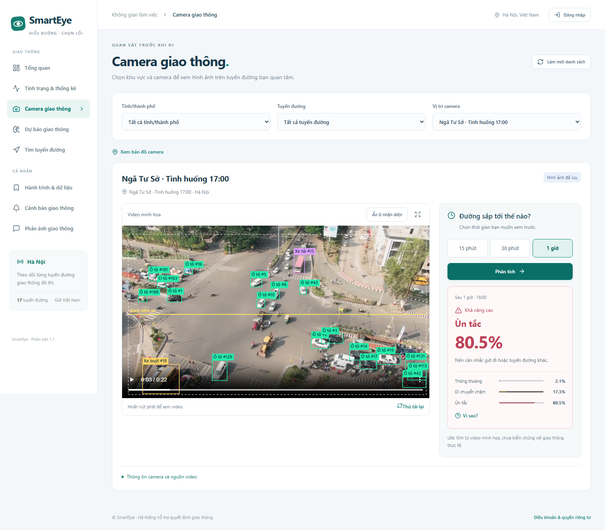

# Kiểm tra pipeline giao thông — 14/11/2026

## Kiểm thử phần mềm

- Toàn bộ backend: **289 bài đạt**, dùng MongoDB 8.0 tạm, tách khỏi dữ liệu đang vận hành.
- Sau khi bổ sung chặn tốc độ/lưu lượng khi camera dịch chuyển: **30 bài liên quan đạt**.
- Playwright: **16 bài đạt** trên máy tính và điện thoại, gồm video, công thức, ba khả năng, ngưỡng thông báo, hủy yêu cầu cũ, phân quyền và luồng xác minh/phát hành cảnh báo.
- TypeScript/Vite và cả hai image Docker build thành công.
- Migration cấu trúc MongoDB thực hiện thành công, giữ bản ghi cũ.
- Bảy camera dùng bảy video riêng đã cập nhật; có ô nhận diện và vạch đếm. Kiểm tra trực tiếp Docker không có lỗi JavaScript hoặc tràn trang trên chiều rộng 1536 px và 390 px.
- Thiếu quan trắc thực trên màn hình huấn luyện trả ba mốc **chưa đủ dữ liệu**, nút huấn luyện bị khóa; không lấy lịch sử mô phỏng làm quan trắc thật.

Các tình huống quan trọng đã kiểm tra: q tính bằng lượt qua vạch, k dùng xe hiện diện; tốc độ 36 km/h từ quãng đường biết trước; không xuất tốc độ khi thiếu hiệu chuẩn hoặc camera trôi; giữ khoảng thời gian thiếu; tách chiều đi/về; không chồng nguồn; không dùng thông tin tương lai trong đặc trưng; bốn phần thời gian có khoảng cách; không tự kích hoạt mô hình; xác suất khác CI; dự báo có phiên bản và không tạo trùng; chỉ chấm khi có nhãn thực tế độc lập.

## Đánh giá mô hình camera minh họa v5

Nguồn: bộ lịch sử mô phỏng đang sử dụng trong Docker, 17 tuyến. Huấn luyện camera dùng 24 ngày hoàn chỉnh gần nhất trong bộ lịch sử 365 ngày. Các phần train, validation, calibration và test theo thời gian; chừa khoảng cách bằng mốc dự báo. Không đưa tập test vào chọn mô hình hoặc hiệu chỉnh xác suất.

| Mốc | Số mẫu test | Accuracy | Macro-F1 | Recall ùn tắc | MAE tốc độ | MAE giữ nguyên tốc độ |
|---|---:|---:|---:|---:|---:|---:|
| 15 phút | 23.460 | 83,98% | 84,64% | 85,33% | 2,35 km/h | 2,80 km/h |
| 30 phút | 23.443 | 78,25% | 79,16% | 81,29% | 3,17 km/h | 4,28 km/h |
| 60 phút | 23.426 | 69,65% | 71,06% | 76,38% | 4,25 km/h | 6,79 km/h |

Đây là kết quả **trên dữ liệu mô phỏng**, không chứng minh độ chính xác ngoài đường. Việc ghép 11 mốc mô phỏng với mốc cuối từ video cũng chưa có bộ quan trắc thực tương ứng để kiểm chứng. Các clip chưa được khảo sát kích thước nên tốc độ/CI hiện tại từ video vẫn để trống, trong khi tốc độ tương lai được đánh dấu là dự tính từ mô hình minh họa.

Thời gian phản hồi quan sát trong một lượt kiểm tra trình duyệt: lượt đầu mỗi camera khoảng 0,9–2,7 giây, sau khi cache thời tiết/mô hình khoảng 0,1–0,4 giây. Đây là số đo trên máy hiện tại, không phải cam kết hiệu năng khi triển khai nhiều người dùng.

## Ảnh bản Docker

[Giao diện điện thoại](previews/traffic-physics-mobile.png) · [Giải thích phép đo](previews/traffic-physics-explanation-desktop.png) · [Giải thích trên điện thoại](previews/traffic-physics-explanation-mobile.png) · [Màn hình dữ liệu và huấn luyện của Quản lý](previews/traffic-physics-management.png).

[Công thức, luồng triển khai và lệnh chạy](TRAFFIC-PIPELINE.md).
