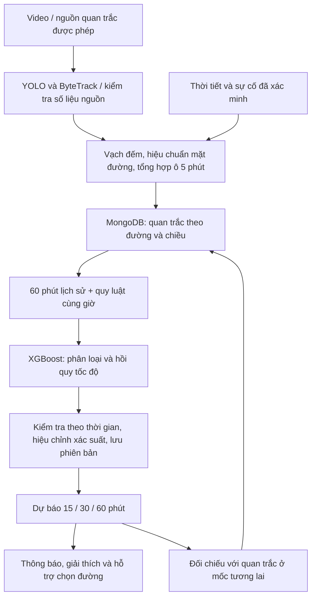

# Quy trình phân tích và dự báo giao thông

Bản triển khai theo sơ đồ sáu bước của đề tài. Có hai chế độ tách biệt:

[Kết quả kiểm thử, đánh giá mô hình minh họa và ảnh Docker](TRAFFIC-PIPELINE-VALIDATION.md).

- **Camera minh họa:** video có nguồn và giấy phép; YOLO11 + ByteTrack nhận diện, bám xe và đếm qua vạch. Lịch sử 365 ngày và các mô hình chạy thử được ghi rõ là mô phỏng. Không nhập video này thành quan trắc thật của tuyến đường mang tên trên giao diện.
- **Quan trắc thực:** dữ liệu có quyền sử dụng, đúng đường và chiều, kích thước đã đo, tốc độ được hiệu chuẩn, nhãn độc lập. Chỉ những mô hình vượt kiểm tra mới được Quản lý đưa vào phục vụ.



## 1. Thu thập đầu vào

Camera cố định quan sát một vùng đường, ưu tiên một chiều lưu thông. Cần biết đường, chiều, thời điểm quay, khoảng quan sát, các mốc kích thước thật và quyền sử dụng. Bốn điểm ảnh và bốn điểm mặt đất tương ứng tạo phép biến đổi phối cảnh để đo chuyển động trên mặt đường.

Video minh họa hiện tại chưa có khảo sát thực địa. Vì vậy, **tốc độ hiện tại, mật độ xe/km và CI từ video sẽ để trống khi chưa đủ hiệu chuẩn**. Chuyển động theo chiều dài thân xe, số xe quy đổi và sức chứa ước lượng vẫn có thể làm đặc trưng chạy thử; chúng không trở thành tốc độ đã đo.

Nguồn số liệu có thể cung cấp tốc độ, số xe hiện diện, lượt qua vạch, khoảng đo, nhãn đã xác minh, mưa và tầm nhìn. Trong **Nguồn dữ liệu → Sửa cấu hình → Tự tổng hợp quan trắc 5 phút**, khai báo chiều dài, số làn, tốc độ thông thoáng, quyền huấn luyện và xác nhận bản ghi là số liệu của một khoảng đo. Sau đó ánh xạ trường, kiểm tra và bật nguồn như luồng đang có. Không coi chu kỳ gọi API là thời gian đã quan sát.

## 2. Công thức và đơn vị

| Đại lượng | Công thức | Ý nghĩa và điều kiện |
|---|---|---|
| Lưu lượng q | N qua vạch / số giây × 3.600 | Xe/giờ của các làn trong vùng đếm. Không dùng tổng ID đã từng nhìn thấy. |
| Mật độ k | N đang hiện diện / (chiều dài m / 1.000) | Xe/km; cần chiều dài vùng đường đã đo. Chia số làn để có xe/km/làn. |
| Tốc độ v | 3,6 × tổng khoảng cách m / tổng thời gian giây | Km/h; khoảng cách trên mặt đất sau hiệu chuẩn, không lấy pixel làm mét. |
| Chỉ số giảm tốc CI | clip(1 − v / v thông thoáng, 0, 1) | Mức suy giảm tốc độ, không phải xác suất xảy ra ùn tắc. |
| Hệ số thời gian TTI | v thông thoáng / v | Thời gian đi qua cùng đoạn so với khi thông thoáng; v = 0 không trả ETA hữu hạn. |
| Thời gian đi qua | L km / v km/h × 60 | Phút; chỉ tính khi tốc độ dương hợp lệ. |
| Tần suất lịch sử | Số ngày tắc / số ngày tương đồng có dữ liệu | Mẫu số loại ngày thiếu số liệu; khác độ chính xác và xác suất mô hình. |

Ví dụ kiểm thử công thức: 150 lượt qua vạch trong 300 giây → 1.800 xe/giờ; 80 xe hiện diện trên 500 m → 160 xe/km; tốc độ 20 km/h so với thông thoáng 40 km/h → CI 50%, TTI 2. Đây là phép tính kiểm thử, không phải quan trắc Hà Nội.

Các mức CI dưới 25%, 25–dưới 50%, 50–dưới 70%, từ 70% lần lượt mô tả mức giảm tốc tăng dần. Đây là bộ ngưỡng thử nghiệm của dự án; **không dùng chúng tự tạo nhãn thực tế FREE/SLOW/JAM**. Đèn đỏ, hàng đợi kéo dài, hướng đi và loại đường cần được kiểm chứng riêng.

Quan hệ q = k × v có điều kiện về cách lấy mẫu và tốc độ trung bình theo không gian. Hệ thống **đo q và k riêng trên dữ liệu thực**, không buộc các số đo camera phải khớp đẳng thức này. Chỉ bộ tạo đặc trưng minh họa dùng giả định dòng ổn định cho q tổng hợp. [FHWA: quan hệ lưu lượng, mật độ, tốc độ](https://ops.fhwa.dot.gov/publications/weatherempirical/sect3.htm). Việc đo tốc độ trong ảnh cần tỷ lệ khoảng cách thật. [Ultralytics: ước lượng tốc độ](https://docs.ultralytics.com/guides/speed-estimation/).

## 3. Tổng hợp 5 phút và kiểm tra chất lượng

`traffic_aggregation.py` tổng hợp nguồn số liệu đang bật, được phép và đã kiểm chứng tốc độ:

1. Mỗi bản ghi ghi thời điểm **kết thúc** khoảng đo và số giây thực tế.
2. Chỉ nhận khoảng nằm trọn trong một ô 5 phút. Khoảng cắt qua biên không được tự chia khi không có dữ liệu thô.
3. Loại ô có các khoảng chồng lấn; cần ít nhất 240 giây quan trắc trong 300 giây.
4. Cộng lượt qua vạch; trung bình số xe hiện diện và tốc độ theo thời gian quan sát. Nguồn chịu trách nhiệm phương pháp đo tốc độ đã khai báo.
5. Không cộng chồng hai camera/nguồn trên cùng đường, chiều và thời điểm. Khi có nhiều nguồn đủ điều kiện cùng chiều, dừng tổng hợp cho đến khi chỉ còn nguồn có thẩm quyền đang bật. Bản nhập đã được duyệt không bị nguồn tự động ghi đè.
6. Nhãn từ nguồn chỉ được dùng khi đã xác nhận phương pháp phân loại độc lập; không tạo nhãn từ CI hoặc từ mô hình.

Một clip 10–40 giây chỉ có số liệu của clip và lưu lượng quy đổi. Nó **không đủ để tự tạo một ô quan trắc 5 phút**, càng không cung cấp một giờ lịch sử thật để dự báo.

## 4. Huấn luyện trên quan trắc thực

Đăng nhập **Quản lý** có quyền **Dữ liệu & mô hình** và phạm vi đường phù hợp. Admin vẫn giữ tài khoản, phân quyền, thiết lập và nhật ký; báo cáo giao thông thuộc Quản lý.

1. Tạo/chọn **tuyến đường thực**, đúng chiều; không nhập dữ liệu thực vào tuyến minh họa.
2. Chọn nội dung **Tình trạng, xác suất và tốc độ từ quan trắc 5 phút**.
3. Tải mẫu CSV hoặc dùng `database/templates/traffic-windows.csv`. Nhập dữ liệu được phép sử dụng; không có bản ghi thật đi kèm mã nguồn.
4. Bấm **Kiểm tra tệp**, đọc số ô đủ chất lượng và các ô sẽ thay thế. Chỉ sau **Xác nhận nhập** mới ghi MongoDB.
5. Chọn từ 7–90 ngày, rồi **Kiểm tra dữ liệu**. Mỗi mẫu cần 12 ô liên tiếp = 60 phút. Không lấp khoảng thiếu bằng 0 hoặc coi thiếu là thông thoáng.
6. Bấm **Huấn luyện tình trạng và tốc độ**. Mỗi mốc 15/30/60 phút có XGBoost phân loại ba trạng thái và XGBoost hồi quy tỷ lệ tốc độ riêng.
7. Xem kết quả, tải CSV báo cáo. Chỉ Quản lý phụ trách toàn bộ phạm vi có quyền kích hoạt mới đưa mô hình đạt kiểm tra vào sử dụng.
8. Mỗi chiều có phiên bản đang phục vụ riêng; kích hoạt chiều đi không ghi đè chiều về.

Đặc trưng gồm diễn biến tốc độ, lưu lượng/làn, mật độ/làn, CI, cờ có/thiếu phép đo, chuyển động/hàng đợi nếu có, mưa, tầm nhìn, sự cố có thông tin, giờ và thứ. Tần suất cùng giờ của các tuần trước được lấy **trước mốc phát hành dự báo**, kèm số ngày có dữ liệu.

Tập dữ liệu được chia theo thời gian: 60% train, 20% dành cho validation và calibration riêng, 20% test. Chừa khoảng cách bằng mốc dự báo giữa các phần để nhãn tương lai của phần trước không tràn vào phần sau. Không xáo trộn ngẫu nhiên các ô thời gian giữa các tập.

Phân loại được so với hai cách đơn giản: giữ nguyên trạng thái và lịch sử cùng giờ. Kiểm tra Macro-F1, Accuracy, Recall ùn tắc, ma trận nhầm lẫn, Brier, log loss và sai lệch hiệu chỉnh xác suất. Tốc độ được kiểm tra MAE và so với giữ nguyên tốc độ, trên từng đường. Các mốc không đạt điều kiện không được phục vụ. Mô hình cũ quá 45 ngày hoặc quan trắc quá 10 phút cần kiểm tra lại.

Pipeline XGBoost/GRU dành cho mật độ và nhãn cũ vẫn giữ để so sánh. Luồng có đầy đủ phép đo giao thông mới dùng XGBoost theo sơ đồ; không tự tuyên bố GRU tốt hơn khi chưa đánh giá.

## 5. Kết quả và phần giải thích

Trang **Camera giao thông** giữ luồng gọn: **chọn video → 15 phút / 30 phút / 1 giờ → Phân tích → một kết quả**. Nút **Vì sao?** mở các phép đo, công thức, lịch sử, thời tiết/sự cố, tốc độ dự báo, CI và sai số thử nghiệm.

Ba xác suất FREE/SLOW/JAM được tính riêng, tổng xấp xỉ 100%. Thông thoáng không lấy bằng 100% trừ ùn tắc vì còn tình trạng di chuyển chậm. Chỉ khi xác suất của trạng thái cao nhất đạt ít nhất 80% mới ghi “Khả năng cao”. Không làm tròn 79,9% thành thông báo đạt 80%.

Tốc độ tương lai là đầu ra hồi quy. CI tương lai tính từ tốc độ đó và tốc độ thông thoáng cùng đường. **CI 65% có thể đi cùng xác suất ùn tắc 74%**; chúng không phải cùng đại lượng. Luồng thực chỉ trả tốc độ khi mô hình hồi quy tốt hơn baseline trên đường tương ứng; không suy tốc độ từ tên trạng thái.

Camera demo sử dụng 11 ô lịch sử mô phỏng và ô mới nhất tổng hợp từ cuối video. Thời tiết khu vực và cảnh báo công bố vẫn chưa xác minh cùng địa điểm/thời gian quay. Kết quả của cách ghép này là thử nghiệm, không phải dự báo giao thông trực tiếp đã kiểm chứng.

## 6. Phục vụ, tìm đường và đối chiếu

Worker hiện có tổng hợp các ô đã hoàn tất, dự báo từ quan trắc mới và đối chiếu kết quả mỗi phút; danh tính mỗi dự báo khóa theo phiên bản, đường, chiều, mốc phát hành và mốc tương lai nên không tạo trùng. Không phát cảnh báo công cộng từ video minh họa. Quy trình xác minh/phát hành cảnh báo hiện có được giữ.

Trên mạng đường do dự án cấu hình, A*/Dijkstra có thể dùng tốc độ dự báo **đã đạt kiểm tra**, đúng chiều và gần thời điểm khởi hành để tính thời gian cạnh L/v. Không áp tốc độ giả cho đoạn chưa có dữ liệu và không ghi đè thời gian của nhà cung cấp bản đồ bên ngoài. Hàm chi phí vẫn cân nhắc thời gian, khoảng cách và mức rủi ro theo lựa chọn người dùng.

Khi có quan trắc và nhãn độc lập đúng mốc tương lai, `traffic_forecast_outcomes` lưu kết quả thực tế, dự báo đúng/sai và sai số tốc độ. Ô không có nhãn không được tự chấm đúng.

## Docker: cập nhật một lần

Trong PowerShell tại thư mục SmartEye, với Docker Desktop đã mở và `.env` đã cấu hình:

```powershell
docker compose up -d --build
docker compose exec backend python scripts/migrate_traffic_schema.py
docker compose exec backend python scripts/setup_camera_videos.py --rush-hour --regions
docker compose ps
Invoke-RestMethod http://localhost:8081/api/health
```

Script migration chỉ cập nhật validator của lần huấn luyện và tạo cấu trúc mới; giữ bản ghi hiện có. Với Docker đang dùng, script dùng thông tin quản trị MongoDB từ biến môi trường riêng cho thao tác migration, không thay quyền tài khoản ứng dụng và không in mật khẩu. Tài khoản MongoDB tùy chỉnh cần quyền `collMod` cho collection này khi migration. [Quyền MongoDB](https://www.mongodb.com/docs/compass/connect/required-access/).

Lệnh chuẩn bị video tái sử dụng tệp và bộ nhận diện đã tải; chỉ tính lại phần cần thiết, không yêu cầu chạy YOLO khi người dùng nhấn Phân tích. Mô hình/lịch sử ở volume dữ liệu, không đưa trọng số hay dữ liệu tài khoản thật lên GitHub. Cổng ở ví dụ là 8081; dùng `FRONTEND_PORT` thực tế trong `.env` nếu khác.

Những lần sau:

```powershell
docker compose up -d
```

Mở `http://localhost:8081/#cameras`, chọn camera, chọn mốc và bấm Phân tích. Muốn dừng dùng `docker compose stop`. Không dùng `down -v` khi cần giữ dữ liệu.

## Thành phần mã nguồn

| Thành phần | Tệp |
|---|---|
| Công thức, đơn vị và giá trị thiếu | `backend/app/traffic_metrics.py` |
| Vạch đếm và biến đổi mặt đường | `backend/app/camera_measurements.py` |
| Ô 5 phút và đối chiếu kết quả | `backend/app/traffic_windows.py`, `traffic_aggregation.py` |
| Đặc trưng, phân loại và hồi quy | `backend/app/traffic_learning.py`, `traffic_forecast.py` |
| Huấn luyện/đăng ký/kích hoạt hiện có | `backend/app/forecast_api.py`, `forecast_ml.py` |
| Dự báo camera minh họa phiên bản 5 | `backend/app/camera_forecast.py` |
| Giao diện video và giải thích | `src/CameraAnalysis.tsx` |
| Nhập và kiểm tra quan trắc thực | `src/TrafficWindowTools.tsx`, `ForecastManagement.tsx` |

Mục tiêu 80–90% phải được chứng minh trên quan trắc thực chưa dùng huấn luyện, kèm số mẫu và kết quả từng mốc. Có một lần dự báo xác suất 90% hoặc đạt Accuracy 90% trên dữ liệu mô phỏng chưa chứng minh điều này.
