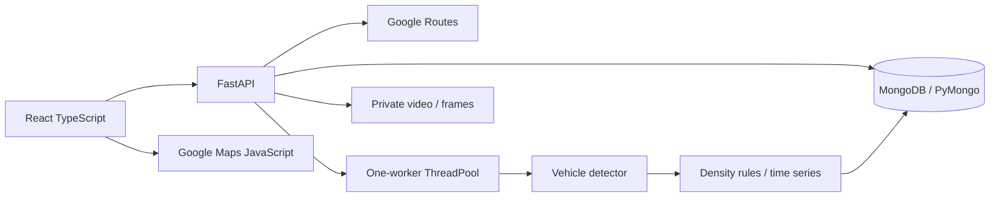
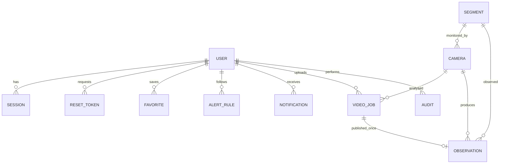

# Kiến trúc

Vite proxy `/api` phát triển; Nginx cùng origin với Docker. Cookie HttpOnly/SameSite=strict, DB chỉ giữ token hash; password scrypt + salt. RBAC từng endpoint; kiểm tra Origin cho mutation. Rate limit theo IP ASGI nhìn thấy; reverse proxy hiện có thể gom nhiều client thành một IP, cần trusted-proxy strategy khi mở rộng.

Geometry JSON `[lat,lng]`. Google matching yêu cầu các điểm của đoạn đã khảo sát và trung điểm cách polyline <=80m; bỏ segment minh họa. Ghép vị trí chỉ bổ sung risk, chưa phân biệt chiều camera/làn đường. Không ghi Google responses vào DB.

`initialize_database()` tạo collection mới với JSONSchema, index unique/history và TTL token. DB standalone hoặc Atlas đều dùng được; không yêu cầu replica set vì hiện không dùng transaction nhiều document. Collection đã tồn tại không tự thay validator; thay đổi schema sau cần migration có chủ đích.

JSON mẫu nằm trong `database/mongodb/`, builder chỉ xuất fixture sạch. `scripts/init_db.py` khởi tạo DB đã cấu hình, có `--demo-accounts` riêng cho development và không ghi đè tài khoản cũ. Có 11 collection nghiệp vụ + counters; xem `database/README.md`. `database_config.py` hỗ trợ MongoDB URI/SRV hoặc host/port/username/password, tự encode thông tin xác thực khi ghép URI từ các trường riêng. SQL cũ chỉ lưu lịch sử, không tham gia runtime.

Mỗi ghi MongoDB atomic trên một document; liên kết collection do API kiểm tra. Counter ID tăng nguyên tử, đồng bộ sau import Compass. Session/reset giữ hash và auth_version; đổi mật khẩu/quyền tăng phiên bản để thu hồi phiên cũ. Reset token dùng findOneAndDelete và guarded update. Unique index bảo vệ email, cảnh báo và công bố video một lần; TTL dọn token hết hạn, API kiểm tra hạn độc lập. Worker cập nhật trạng thái có điều kiện để không ghi đè thao tác hủy đồng thời. Repository chỉ ghi trường thay đổi.

Một ThreadPoolExecutor và model có lock; tên file UUID, không dùng đường dẫn user. Kết quả samples JSON; ảnh mỗi 10 giây. Worker cập nhật progress và kiểm tra cancel từng frame. Deploy một process; nâng Celery/Redis khi cần nhiều máy/phục hồi jobs. Process kill có thể để orphan JPEG: cần chính sách dọn storage khi vận hành dài hạn.

Demo heap tìm tối đa 3 simple paths theo ETA trong graph nhỏ, không phải optimizer toàn Hà Nội. Google chỉ so route candidates provider trả; risk traffic theo độ dài polyline, camera bổ sung risk, giữ ETA. Score chỉ so trong một yêu cầu, không so tuyệt đối giữa các lần khác thời điểm.
