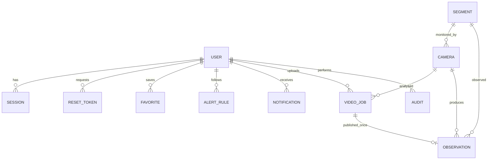

# Kiến trúc

Vite proxy `/api` phát triển; Nginx cùng origin với Docker. Cookie HttpOnly/SameSite=strict, DB chỉ giữ token hash; password scrypt + salt. RBAC từng endpoint; kiểm tra Origin cho mutation. Rate limit theo IP ASGI nhìn thấy; reverse proxy hiện có thể gom nhiều client thành một IP, cần trusted-proxy strategy khi mở rộng.

Geometry JSON `[lat,lng]`. Google matching yêu cầu các điểm của đoạn đã khảo sát và trung điểm cách polyline <=80m; bỏ segment minh họa. Ghép vị trí chỉ bổ sung risk, chưa phân biệt chiều camera/làn đường. Không ghi Google responses vào DB.

`Base.metadata.create_all` tạo schema; migration thêm `is_demo` hỗ trợ DB đã tạo trước đó. Thay đổi schema sau cần migration mới. PostgreSQL lưu JSON; chưa dùng PostGIS.

Một ThreadPoolExecutor và model có lock; tên file UUID, không dùng đường dẫn user. Kết quả samples JSON; ảnh mỗi 10 giây. Worker cập nhật progress và kiểm tra cancel từng frame. Deploy một process; nâng Celery/Redis khi cần nhiều máy/phục hồi jobs. Process kill có thể để orphan JPEG: cần chính sách dọn storage khi vận hành dài hạn.

Demo heap tìm tối đa 3 simple paths theo ETA trong graph nhỏ, không phải optimizer toàn Hà Nội. Google chỉ so route candidates provider trả; risk traffic theo độ dài polyline, camera bổ sung risk, giữ ETA. Score chỉ so trong một yêu cầu, không so tuyệt đối giữa các lần khác thời điểm.
