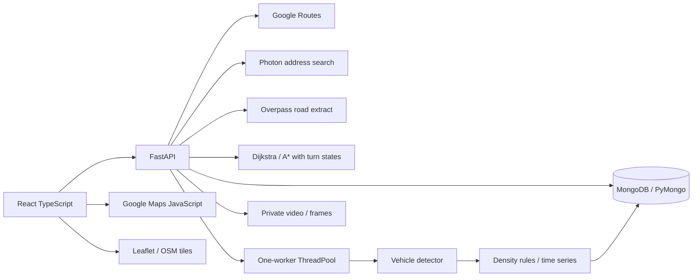
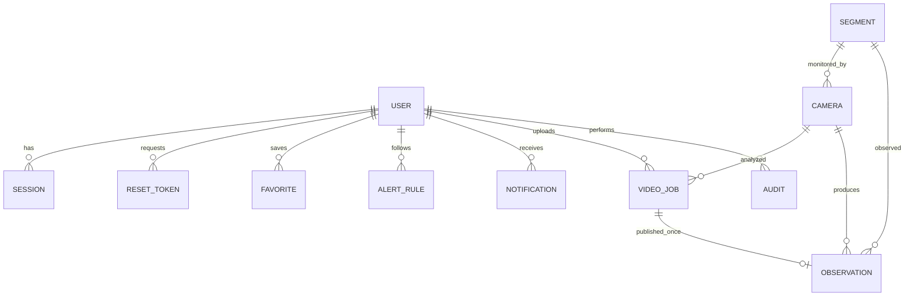

# Kiến trúc

Vite proxy `/api` phát triển; Nginx cùng origin với Docker. Cookie HttpOnly/SameSite=strict, DB chỉ giữ token hash; password scrypt + salt. RBAC từng endpoint; kiểm tra Origin cho mutation. Rate limit theo IP ASGI nhìn thấy; reverse proxy hiện có thể gom nhiều client thành một IP, cần trusted-proxy strategy khi mở rộng.

Geometry JSON `[lat,lng]`. Google matching yêu cầu các điểm của đoạn đã khảo sát và trung điểm cách polyline <=80m; bỏ segment minh họa. Ghép vị trí chỉ bổ sung risk, chưa phân biệt chiều camera/làn đường. Không ghi Google responses vào DB.

`initialize_database()` tạo collection mới với JSONSchema, index unique/history và TTL token. DB standalone hoặc Atlas đều dùng được; không yêu cầu replica set vì hiện không dùng transaction nhiều document. Collection đã tồn tại không tự thay validator; thay đổi schema sau cần migration có chủ đích.

JSON mẫu nằm trong `database/mongodb/`, builder chỉ xuất fixture sạch. `scripts/init_db.py` khởi tạo DB đã cấu hình, có `--demo-accounts` riêng cho development và không ghi đè tài khoản cũ. Có 15 collection nghiệp vụ + counters; xem `database/README.md`. `database_config.py` hỗ trợ MongoDB URI/SRV hoặc host/port/username/password, tự encode thông tin xác thực khi ghép URI từ các trường riêng. SQL cũ chỉ lưu lịch sử, không tham gia runtime.

`traffic_samples` lưu chuỗi mẫu đã được công bố theo thời điểm quay; dữ liệu cũ chỉ có observation vẫn được thống kê bằng fallback, tránh đếm trùng khi có mẫu chi tiết. API lịch sử chuẩn hóa theo camera/ô 5 phút và múi giờ UTC+7. Mẫu được đọc qua index và cộng dồn trong bộ nhớ theo ô, không giữ toàn bộ khung hình thô trong RAM. Tuyến khởi hành sau trên 5 phút dùng mô hình đã kích hoạt khi khớp mốc dự báo, sau đó tham khảo lịch sử đủ số ngày cùng thứ/giờ nếu thiếu dự báo; không dùng camera hiện tại như dự báo. Xem `docs/CAMERAS.md`.

Mỗi ghi MongoDB atomic trên một document; liên kết collection do API kiểm tra. Counter ID tăng nguyên tử, đồng bộ sau import Compass. Session/reset giữ hash và auth_version; đổi mật khẩu/quyền tăng phiên bản để thu hồi phiên cũ. Reset token dùng findOneAndDelete và guarded update. Unique index bảo vệ email, cảnh báo và công bố video một lần; TTL dọn token hết hạn, API kiểm tra hạn độc lập. Worker cập nhật trạng thái có điều kiện để không ghi đè thao tác hủy đồng thời. Repository chỉ ghi trường thay đổi.

Một ThreadPoolExecutor và model có lock; tên file UUID, không dùng đường dẫn user. Kết quả samples JSON; ảnh mỗi 10 giây. Worker cập nhật progress và kiểm tra cancel từng frame. Deploy một process; nâng Celery/Redis khi cần nhiều máy/phục hồi jobs. Process kill có thể để orphan JPEG: cần chính sách dọn storage khi vận hành dài hạn.

Dijkstra và A* tối ưu tổng chi phí cạnh theo thời gian/khoảng cách và mức phạt rủi ro tùy chọn. Hai mốc chuẩn hóa là tuyến nhanh nhất và ngắn nhất trên cùng đồ thị. A* dùng cận Haversine đã hiệu chỉnh theo tất cả cạnh; Yen tạo tối đa ba tuyến thay thế. Đường một chiều được tôn trọng. Google chỉ xếp hạng tập ứng viên provider trả, giữ ETA, không chạy Dijkstra/A* trên mạng Google. Xem ROUTING.md; điểm chỉ so trong cùng yêu cầu.

Mô-đun dự báo: forecast_data tạo cửa sổ 5 phút / 60 phút, forecast_ml huấn luyện XGBoost CPU và GRU PyTorch, forecast_api quản lý dữ liệu/nhãn/tác vụ/kích hoạt. Một worker dự báo riêng; artifact giữ trong backend/data/forecasts. Mô hình phải vượt kiểm tra theo thời gian, baseline và phạm vi từng tuyến trước khi phục vụ. Xem docs/FORECASTING.md.

Bản đồ đường phố: TrafficMap dùng Leaflet/OSM và giữ Google Maps riêng cho nội dung Google. map_services cung cấp gợi ý Photon, tải vùng Overpass có timeout/fallback/cache; osm_routing dựng đồ thị đường theo phương tiện, snap ghim và trạng thái cạnh đi vào để xét hạn chế rẽ. Cạnh hình học được nén, giữ polyline/chiều dài. Chỉ ghép quan sát từ đoạn khảo sát thật; không dùng seed demo cho ETA OSM. Nguồn công cộng có giới hạn khả dụng; chi tiết, phạm vi tối ưu và kiểm chứng tại docs/MAPS.md.
