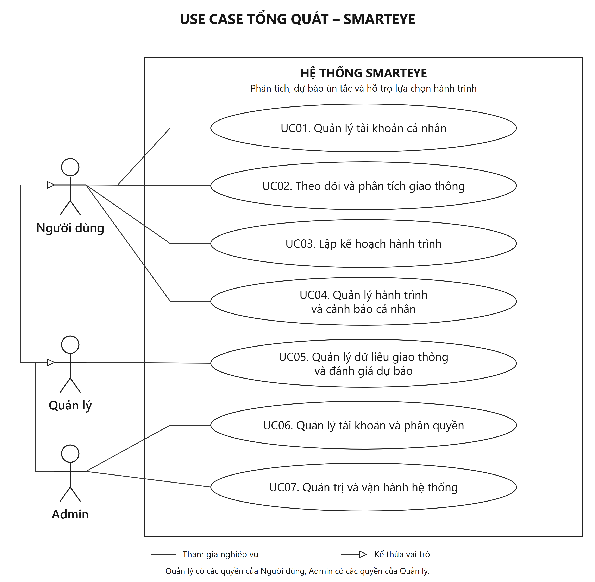

# Use Case tổng quát – SmartEye

Sơ đồ gom các chức năng hiện có thành bảy mục tiêu nghiệp vụ lớn. Các thao tác như nhập địa chỉ, chọn ngày/giờ, đăng nhập hoặc đánh dấu đã đọc được trình bày trong đặc tả chi tiết, không tách thành hàng loạt Use Case nhỏ ở sơ đồ tổng quát.

## Tác nhân và quan hệ

- **Người dùng:** sử dụng các nghiệp vụ cá nhân và tra cứu thông tin giao thông.
- **Quản lý:** có các quyền của Người dùng; quản lý lịch sử giao thông, kiểm tra dữ liệu, đánh giá dự báo và lập báo cáo.
- **Admin:** có các quyền của Quản lý; quản lý tài khoản, phân quyền và vận hành hệ thống.

Đường liền nối tác nhân với Use Case biểu diễn sự tham gia, không thể hiện thứ tự thực hiện. Mũi tên có tam giác rỗng chỉ về tác nhân tổng quát: **Quản lý → Người dùng**, **Admin → Quản lý**. Nhờ kế thừa, không cần vẽ lặp lại các liên kết dùng chung.

## Các nghiệp vụ cấp cao

| Mã | Use Case tổng quát | Tác nhân tham gia | Phạm vi nghiệp vụ |
|---|---|---|---|
| UC01 | Quản lý tài khoản cá nhân | Người dùng; Quản lý và Admin kế thừa | Đăng ký khi chưa có tài khoản; đăng nhập, cập nhật hồ sơ, đổi hoặc khôi phục mật khẩu và đăng xuất. |
| UC02 | Theo dõi và phân tích giao thông | Người dùng; Quản lý và Admin kế thừa | Chọn tuyến đường; xem tình trạng, lịch sử theo ngày/tháng/năm; so sánh các tháng và giờ cao điểm theo từng thứ để nhận biết quy luật giao thông. |
| UC03 | Lập kế hoạch hành trình | Người dùng; Quản lý và Admin kế thừa | Chọn tuyến hoặc điểm đi/đến và thời điểm dự định; xem dự báo, giờ nên tránh; so sánh tuyến theo thời gian/khoảng cách và so sánh giờ khởi hành để lựa chọn hành trình phù hợp. |
| UC04 | Quản lý hành trình và cảnh báo cá nhân | Người dùng; Quản lý và Admin kế thừa | Lưu và sử dụng lại hành trình yêu thích; theo dõi tuyến quan tâm, thiết lập điều kiện cảnh báo, xem và quản lý thông báo trong ứng dụng. |
| UC05 | Quản lý dữ liệu giao thông và đánh giá dự báo | Quản lý; Admin kế thừa | Nhập, kiểm tra và bổ sung lịch sử; xác nhận nhãn tình trạng giao thông; cập nhật, kiểm tra và so sánh kết quả dự báo; xem/xuất báo cáo. |
| UC06 | Quản lý tài khoản và phân quyền | Admin | Tra cứu tài khoản; gán vai trò; khóa/mở tài khoản và thu hồi phiên đăng nhập để kiểm soát quyền truy cập. |
| UC07 | Quản trị và vận hành hệ thống | Admin | Quản lý tuyến đường và cấu hình nguồn theo dõi; cho phép hoặc ngừng sử dụng bản dự báo đủ điều kiện; theo dõi trạng thái và nhật ký hoạt động. |

## Ví dụ một kịch bản tổng quát của UC03

**Mục tiêu:** chọn hành trình và giờ khởi hành phù hợp để hạn chế gặp ùn tắc.

1. Người dùng chọn tuyến hoặc nhập điểm xuất phát, điểm đến và thời điểm dự định, ví dụ 17:00 ngày mai.
2. Hệ thống xem xét lịch sử liên quan và trả dự báo cho khung giờ đã chọn.
3. Người dùng xem các khoảng nên cân nhắc tránh, gợi ý giờ khác và những tuyến được đề xuất.
4. Người dùng so sánh thời gian, khoảng cách và các giờ khởi hành liền kề.
5. Người dùng lựa chọn hành trình phù hợp; có thể lưu để dùng lại qua UC04.

Đây là một mục tiêu nghiệp vụ gồm nhiều bước liên kết, không chỉ là thao tác “bấm xem dự báo” hoặc “nhập địa chỉ”. Luồng thay thế: thiếu lịch sử, không tìm được đường hoặc nguồn bản đồ chưa phản hồi thì hệ thống thông báo để người dùng điều chỉnh thông tin hoặc thử lại.

Các chức năng tra cứu công khai có thể dùng trước đăng nhập. Những nghiệp vụ lưu thông tin cá nhân, theo dõi cảnh báo hoặc quản trị yêu cầu đăng nhập và đúng quyền; đăng nhập là điều kiện truy cập, không phải một quan hệ `include` bắt buộc cho mọi lần tra cứu. Cảnh báo hiện tại dựa trên quan sát đủ điều kiện; dữ liệu minh họa không tự phát cảnh báo thực.

## Căn cứ trong dự án

- Tài khoản cá nhân: `src/Auth.tsx`, các đường dẫn xác thực trong `backend/app/main.py`.
- Theo dõi và phân tích: `src/OverviewPage.tsx`, `src/TrafficMonitor.tsx`, `backend/app/history.py`.
- Lập kế hoạch: `src/ForecastPage.tsx`, `src/RoutesPage.tsx`, `backend/app/calendar_forecast.py`, `backend/app/departure_planning.py`.
- Hành trình/cảnh báo: `HistoryPage`, `AlertsPage` trong `src/WorkspacePages.tsx` và các đường dẫn tương ứng trong `backend/app/main.py`.
- Dữ liệu và đánh giá dự báo: `src/ForecastManagement.tsx`, `backend/app/forecast_api.py`; quyền Quản lý/Admin được kiểm tra bằng `operator`.
- Quản trị: `AdminPage` trong `src/WorkspacePages.tsx`, các đường dẫn quản trị trong `backend/app/main.py`; việc kích hoạt/ngừng bản dự báo được giới hạn cho Admin.

## Tệp sử dụng

- [PNG độ phân giải cao](use-case-tong-quat.png): chèn vào báo cáo.
- [SVG vector](use-case-tong-quat.svg): phóng to hoặc chèn vào Word mà giữ độ nét.
- [Draw.io](use-case-tong-quat.drawio): mở bằng diagrams.net để chỉnh sửa tác nhân, hình và liên kết.
- [PlantUML](use-case-tong-quat.puml): mã nguồn mô tả sơ đồ.
